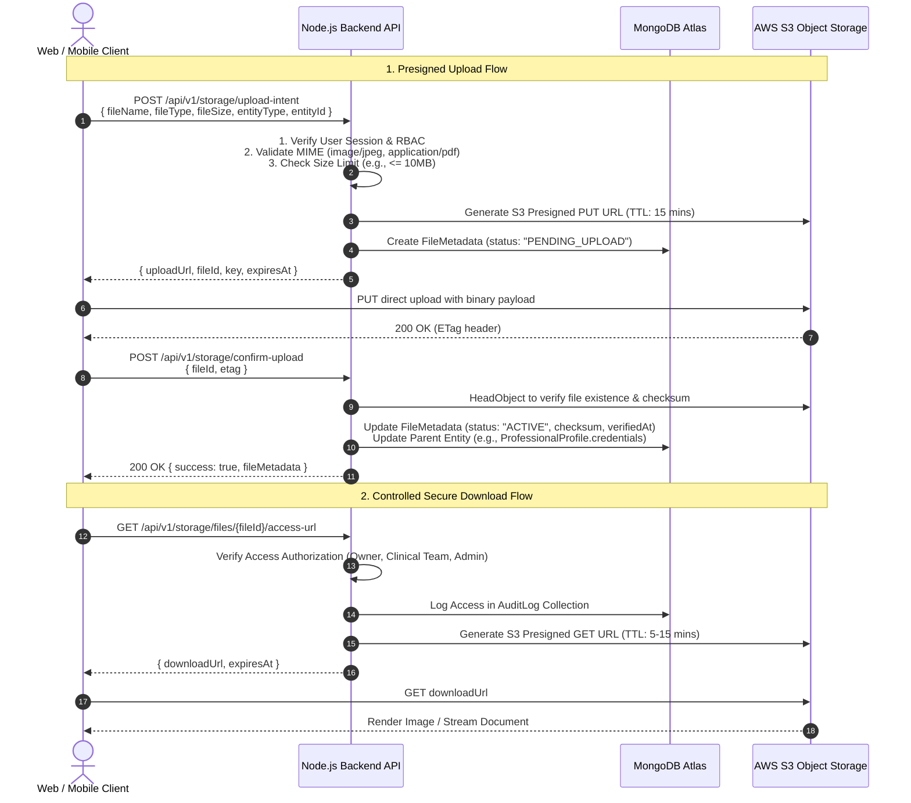

# VivoQuest System Architecture Document
*MongoDB & Object Storage Edition*

## 1. Executive Summary & Project Vision

**VivoQuest** is an India-focused, AI-enabled healthcare marketplace connecting patients, families, healthcare professionals, hospitals, and medical equipment (DME) suppliers. Rather than relying on traditional hospital staffing models with prohibitive payroll overhead, VivoQuest operates as an asset-light, closed-loop orchestrator for preventive home healthcare.

### Core Architecture Pillars
1. **Tripartite Marketplace Ecosystem**:
   - **Demand (Payers & Hospitals)**: Health plans, hospitals, ACOs, and families seeking preventive care, HEDIS care-gap closures, and readmission prevention.
   - **Supply (Clinical Talent & DME Depots)**: Non-nurse specialists (phlebotomists, social workers/CHWs, dietitians, physical therapists) and local medical equipment depots.
   - **Matchmaker (AI Logistics & Clinical Bundling)**: Proprietary dispatch algorithm that groups discrete care gaps into multi-service **"Super-Visit Bundles"** to collapse multiple appointments into a single high-impact home visit.
2. **Primary Application Database: MongoDB**:
   - High-flexibility schema using **Mongoose ODM** for strict schema validation, type safety, and lifecycle hooks.
   - Deployed on **MongoDB Atlas** for high-availability multi-region clustering and localized AWS Mumbai (`ap-south-1`) data residency compliant with India's DPDP Act.
3. **Decoupled Cloud Object Storage (AWS S3)**:
   - S3 or S3-compatible object storage (e.g., MinIO for local development) for all user images, DME catalog photos, provider credential documents, and clinical records.
   - Direct-to-storage presigned upload URLs with metadata, ownership, and RBAC permissions recorded in MongoDB.
   - **Strict prohibition of large Base64 blobs** in MongoDB documents.
4. **Compassionate, Trust-First Visual Identity**:
   - Inspired by the accessibility and authority of **eSanjeevani (MoHFW)** and the empathetic palliative care delivery of **Palcare India**, without copying logos or claiming government affiliation.

---

## 2. High-Level System Architecture

```mermaid
graph TD
    subgraph Clients ["Client Applications"]
        WebPortal["Web Dashboards (Next.js 15)<br/>Payer | Hospital | Supplier | Admin"]
        MobileApp["Provider Mobile App (React Native Expo)<br/>Offline-First | GPS | Barcode Scanner"]
        PatientPortal["Patient & Caregiver Portal<br/>Multilingual PWA & WhatsApp Flow"]
    end

    subgraph Gateway ["API Gateway & Ingestion Layer"]
        APIGateway["Node.js / Express REST API Gateway<br/>JWT Auth | RBAC | Audit Logging | Rate Limiting"]
        IngestionAPI["Discharge & Care Gap Ingestion<br/>FHIR / HL7 / CSV Webhooks"]
    end

    subgraph CoreBackend ["Marketplace Core Services (Node.js/TypeScript)"]
        UserSvc["Auth, Credentialing & RBAC"]
        MarketplaceSvc["Orders, DME Catalog & Scheduling"]
        VisitSvc["Super-Visit State Machine"]
        StorageSvc["Storage & Presigned URL Engine"]
        AuditSvc["DPDP Consent & Audit Ledger"]
    end

    subgraph AIServices ["AI & Optimization Engine (Python/FastAPI)"]
        BundlingEngine["Clinical Bundling Engine<br/>Care Gap Stacking"]
        DispatchEngine["Dynamic Dispatch & Router<br/>OR-Tools + Mapbox Matrix"]
        LLMDocEngine["Medical LLM & Coding Engine<br/>ICD-10 / CPT & Summaries"]
        CommAgent["Omnichannel Outreach Agents<br/>Gupshup WhatsApp & Twilio SMS"]
    end

    subgraph DataStorage ["Data & Storage Layer"]
        MongoAtlas[("MongoDB Atlas / MongoDB 8.x<br/>User, Visit, DME, Metadata & Audit Collections")]
        S3Storage[("AWS S3 Encrypted Storage<br/>Profile Pics, Credential Docs, DME Photos, Lab Summaries")]
        RedisCache[("Redis Caching & Queue")]
    end

    subgraph External ["External Integrations"]
        ABDM["ABDM / ABHA ID & DigiLocker"]
        EMR["Hospital EMRs / Redox FHIR"]
        DME["Local DME Supplier Systems"]
        Comms["WhatsApp (Gupshup) / Twilio"]
        Payments["Razorpay Marketplace Rails"]
    end

    WebPortal -->|HTTPS / REST| APIGateway
    MobileApp -->|HTTPS / Offline Sync| APIGateway
    PatientPortal -->|HTTPS / Webhooks| APIGateway

    IngestionAPI --> APIGateway
    APIGateway --> CoreBackend

    CoreBackend <-->|Mongoose ODM| MongoAtlas
    StorageSvc -->|Generate Presigned URLs| S3Storage
    Clients -.->|Direct Upload via Presigned PUT| S3Storage
    Clients -.->|Secure Download via Presigned GET| S3Storage

    MarketplaceSvc <-->|REST / gRPC| AIServices
    VisitSvc <-->|Dispatch Request| DispatchEngine
    VisitSvc --> LLMDocEngine

    CoreBackend --> RedisCache
    CoreBackend --> ABDM
    CoreBackend --> DME
    CoreBackend --> Comms
    CoreBackend --> Payments
    IngestionAPI <--> EMR
```



---

## 3. Image & File Storage Architecture

Storing binary files or large Base64 strings directly in MongoDB causes document bloat, degrades memory cache performance, and exceeds the BSON 16MB limit. VivoQuest uses a **Direct-to-Storage Presigned URL Architecture**.



### 3.1 Upload Intent & File Constraints
* **Profile Pictures**: `image/jpeg`, `image/png`, `image/webp` (Max 5MB).
* **DME Product Images**: `image/jpeg`, `image/png`, `image/webp` (Max 10MB).
* **Credential Documents**: `application/pdf`, `image/jpeg`, `image/png` (Max 15MB).
* **Clinical Records & Summaries**: `application/pdf` (Max 20MB).
* **Malware Scanning Hook**: S3 ObjectCreated event triggers an AWS Lambda or ClamAV container to scan files; infected files are automatically quarantined and marked `QUARANTINED` in MongoDB.

### 3.2 Role of MongoDB GridFS
* **Primary Policy**: AWS S3 is the standard object store.
* **GridFS Scope**: Considered exclusively for edge environments or isolated hospital intranet deployments where cloud object storage is restricted by local network policies.

---

## 4. MongoDB Data Models & Schema Design (Mongoose)

All data models are defined using Mongoose with strict schema validation, timestamping, indexing, and field-level access control.

### 4.1 FileMetadata Schema (`files`)
Tracks all uploaded assets and controls access boundaries:
```typescript
interface IFileMetadata {
  _id: Types.ObjectId;
  storageProvider: 'S3' | 'GRIDFS' | 'MINIO';
  bucket: string;
  key: string;                       // S3 object key (e.g., 'credentials/org_123/prv_456/license.pdf')
  originalName: string;
  mimeType: string;
  sizeBytes: number;
  checksumSha256?: string;
  ownership: {
    uploadedBy: Types.ObjectId;      // User reference
    organizationId?: Types.ObjectId; // Hospital or DME depot
  };
  associatedEntity: {
    entityType: 'USER_PROFILE' | 'PATIENT' | 'PROVIDER_CREDENTIAL' | 'DME_PRODUCT' | 'VISIT_RECORD';
    entityId: Types.ObjectId;
  };
  accessControl: {
    accessLevel: 'PUBLIC' | 'RESTRICTED' | 'CONFIDENTIAL_CLINICAL';
    allowedRoles: string[];          // e.g., ['SUPER_ADMIN', 'HOSPITAL_OPERATOR', 'FIELD_PROVIDER']
    authorizedUsers: Types.ObjectId[];
  };
  status: 'PENDING_UPLOAD' | 'ACTIVE' | 'QUARANTINED' | 'ARCHIVED';
  retentionUntil?: Date;
  createdAt: Date;
  updatedAt: Date;
}
```

### 4.2 User & Profile Schemas
```typescript
// Core Authentication Identity
interface IUser {
  _id: Types.ObjectId;
  phone: string;                     // Primary login via OTP (+91...)
  phoneHash: string;                 // Indexed SHA-256 for lookup
  email?: string;
  role: 'PATIENT' | 'CAREGIVER' | 'FIELD_PROVIDER' | 'HOSPITAL_OPERATOR' | 'DME_SUPPLIER' | 'PAYER_MANAGER' | 'ADMIN';
  status: 'ACTIVE' | 'PENDING_VERIFICATION' | 'SUSPENDED';
  mfaEnabled: boolean;
  avatarFileId?: Types.ObjectId;     // Ref: FileMetadata
  createdAt: Date;
  updatedAt: Date;
}

// Healthcare Professional Profile
interface IProfessionalProfile {
  _id: Types.ObjectId;
  userId: Types.ObjectId;            // Ref: User
  fullName: string;
  specialties: ('PHLEBOTOMY' | 'SOCIAL_WORK' | 'DIETETICS' | 'PHYSICAL_THERAPY' | 'DME_SETUP')[];
  registrationNumber: string;        // Medical / Paramedical Council ID
  stateOfRegistration: string;
  credentials: {
    documentType: 'STATE_LICENSE' | 'PHLEBOTOMY_CERT' | 'BACKGROUND_CHECK' | 'AADHAAR_VERIFIED';
    fileId: Types.ObjectId;          // Ref: FileMetadata (CONFIDENTIAL)
    verificationStatus: 'PENDING' | 'VERIFIED' | 'REJECTED';
    verifiedAt?: Date;
    verifiedBy?: Types.ObjectId;
    expiryDate?: Date;
  }[];
  activeStatus: 'AVAILABLE' | 'ON_DUTY' | 'OFFLINE';
  serviceRadiusKm: number;
  currentLocation?: {
    type: 'Point';
    coordinates: [number, number];   // [longitude, latitude] for geospatial queries
  };
  ratingAverage: number;
  superVisitsCompleted: number;
}

// Patient & Caregiver Profile
interface IPatientProfile {
  _id: Types.ObjectId;
  userId: Types.ObjectId;            // Ref: User
  abhaId?: string;                   // Ayushman Bharat Health Account ID
  fullName: string;
  dateOfBirth: Date;
  gender: 'MALE' | 'FEMALE' | 'OTHER';
  emergencyContact: {
    name: string;
    relationship: string;
    phone: string;
  };
  primaryAddress: {
    line: string;
    city: string;
    state: string;
    pincode: string;
    location: {
      type: 'Point';
      coordinates: [number, number]; // [lng, lat]
    };
  };
  assignedCaregivers: Types.ObjectId[]; // Ref: User
  activeConditions: string[];        // ICD-10 codes (e.g., E11.9, I10)
  allergies: string[];
  medicalDocs: {
    title: string;
    fileId: Types.ObjectId;          // Ref: FileMetadata
    uploadedAt: Date;
  }[];
}
```

### 4.3 DME Product & Supplier Schema
```typescript
interface IDMEProduct {
  _id: Types.ObjectId;
  productCode: string;               // e.g., 'DME-WALKER-01'
  title: string;                     // e.g., 'Heavy Duty Foldable Walker'
  category: 'MOBILITY' | 'RESPIRATORY' | 'BATHROOM_SAFETY' | 'MONITORING_DEVICES';
  description: string;
  images: {
    fileId: Types.ObjectId;          // Ref: FileMetadata (PUBLIC/RESTRICTED)
    isPrimary: boolean;
  }[];
  specifications: Record<string, string>;
  supplierId: Types.ObjectId;        // Organization reference
  stockQuantity: number;
  availableDepots: {
    depotName: string;
    depotLocation: {
      type: 'Point';
      coordinates: [number, number];
    };
    inStock: number;
  }[];
  isRentalAvailable: boolean;
  rentalPerDayInr?: number;
  purchasePriceInr?: number;
}
```

### 4.4 Service Request & Super-Visit Record Schema
```typescript
interface ISuperVisitRecord {
  _id: Types.ObjectId;
  bundleCode: string;                // e.g., 'SVB-2026-10029'
  patientId: Types.ObjectId;         // Ref: PatientProfile
  payerOrganizationId?: Types.ObjectId;
  hospitalSourceId?: Types.ObjectId;
  scheduledDate: Date;
  timeWindow: { start: string; end: string };
  bundledTasks: {
    taskId: string;
    taskType: 'LAB_A1C_DRAW' | 'SDOH_SAFETY_CHECK' | 'DME_DELIVERY_SETUP' | 'NUTRITION_ASSESSMENT';
    requiredCredential: string;
    dmeProductCode?: string;
    status: 'PENDING' | 'COMPLETED' | 'UNABLE_TO_COMPLETE';
    resultData?: Record<string, unknown>;
    specimenBarcode?: string;        // Scanned at kitchen table
  }[];
  assignedProviderId?: Types.ObjectId; // Ref: ProfessionalProfile
  visitStatus: 'DRAFT' | 'BUNDLED' | 'DISPATCHED' | 'IN_TRANSIT' | 'ARRIVED' | 'COMPLETED' | 'VERIFIED';
  fieldVerification: {
    checkInLocation?: {
      type: 'Point';
      coordinates: [number, number];
    };
    checkInTime?: Date;
    checkOutTime?: Date;
    proofPhotos: Types.ObjectId[];   // Ref: FileMetadata (DME setup photos)
    patientSignatureFileId?: Types.ObjectId;
    careSummaryText?: string;
    suggestedBillingCodes?: { code: string; type: 'ICD10' | 'CPT'; description: string }[];
  };
  auditTrail: {
    status: string;
    changedAt: Date;
    changedBy: Types.ObjectId;
    note?: string;
  }[];
}
```

### 4.5 Consent & Audit Ledger Schemas (DPDP Act Compliance)
```typescript
interface IConsentRecord {
  _id: Types.ObjectId;
  patientId: Types.ObjectId;
  consentType: 'HOME_VISIT_CARE' | 'LAB_SAMPLE_COLLECTION' | 'DME_DATA_SHARING' | 'AI_CLINICAL_SUMMARIZATION';
  status: 'GRANTED' | 'REVOKED' | 'EXPIRED';
  purposeDescription: string;
  grantedAt: Date;
  expiresAt: Date;
  ipAddress?: string;
  signatureFileId?: Types.ObjectId;  // Ref: FileMetadata
}

interface IAuditLog {
  _id: Types.ObjectId;
  actorId: Types.ObjectId;
  actorRole: string;
  action: 'READ' | 'CREATE' | 'UPDATE' | 'DELETE' | 'PRESIGNED_URL_GENERATED' | 'DOWNLOAD';
  resourceType: 'PATIENT_RECORD' | 'CREDENTIAL_DOCUMENT' | 'VISIT_SUMMARY' | 'LAB_SPECIMEN';
  resourceId: Types.ObjectId;
  ipAddress: string;
  userAgent: string;
  timestamp: Date;
  metadata?: Record<string, unknown>;
}
```

---

## 5. Security, Authorization & Privacy Controls

1. **Private by Default**:
   - Patient health records and provider licensing files are stored with access level `CONFIDENTIAL_CLINICAL`.
   - Direct public S3 access is disabled via S3 Block Public Access; files are accessible strictly via temporary signed URLs with 5 to 15 minute TTL.
2. **India DPDP Act (2023) Compliance**:
   - **Data Residency**: MongoDB Atlas cluster and S3 buckets are hosted in the **AWS Mumbai (`ap-south-1`) region**.
   - **Data Minimization**: The mobile provider view only delivers relevant patient address and task instructions; historical EMR records remain shielded.
   - **Consent Verification**: Before generating a presigned URL or dispatching a visit, the backend checks for an active `ConsentRecord`.
3. **Auditability**:
   - Every presigned URL issuance is logged in the `AuditLog` collection with actor identity, target document ID, and timestamp.

---

## 6. Design System & Visual Foundation

Inspired by the public health authority of **eSanjeevani (MoHFW)** and the compassionate home care delivery of **Palcare India**:

| Role | Color Name | Hex Code | Visual Application |
| :--- | :--- | :--- | :--- |
| **Primary Brand** | Blue | `#1976D2` | Institutional healthcare trust, primary actions, active navigation |
| **Vitality & Health** | Green | `#2E9E6F` | Medical verification badges, completed tasks, care-gap closure |
| **Typography & Structure** | Navy | `#17324D` | Authoritative text headings, dark navbar, high contrast |
| **Canvas Background** | Light Blue | `#F4F9FC` | Calming background canvas reducing cognitive strain |
| **Card & Surfaces** | White | `#FFFFFF` | Sterile, crisp card surfaces, modals, elevated sheets |
| **Divider & Outlines** | Border Gray | `#D9E3EA` | Subtle component borders and table separators |
| **Success** | Success Green | `#28A745` | Positive clinical alerts, verified specimen barcode scans |
| **Warning** | Warning Amber | `#F4A62A` | Approaching visit windows, pending document validations |
| **Error / Alert** | Alert Red | `#D9534F` | Critical biometrics, missed visits, invalid credentials |

---

## 7. Monorepo Structure

```
vivoquest/
├── apps/
│   ├── web/                  # Next.js 15+ Web Dashboards (Payer, Hospital, Supplier, Admin)
│   ├── mobile/               # React Native Expo 51+ Provider & Field App
│   ├── api/                  # Node.js + TypeScript REST & Marketplace Engine (Mongoose)
│   └── ai-services/          # Python 3.11 + FastAPI Clinical Bundling & Dispatch Engine
├── packages/
│   ├── shared-types/         # Zod schemas & TypeScript types (Files, Patients, Bundles, Tasks)
│   └── design-tokens/        # Tailwind preset, CSS variables, healthcare palette tokens
├── docs/
│   ├── architecture.md       # Complete system architecture specification (MongoDB + S3)
│   └── implementation-plan.md# 8-week phased roadmap & acceptance criteria
├── .env.example              # Sanitized environment template (MongoDB Atlas + AWS S3)
├── .gitignore                # Production-grade gitignore
└── README.md                 # Project orientation and developer runbook
```
