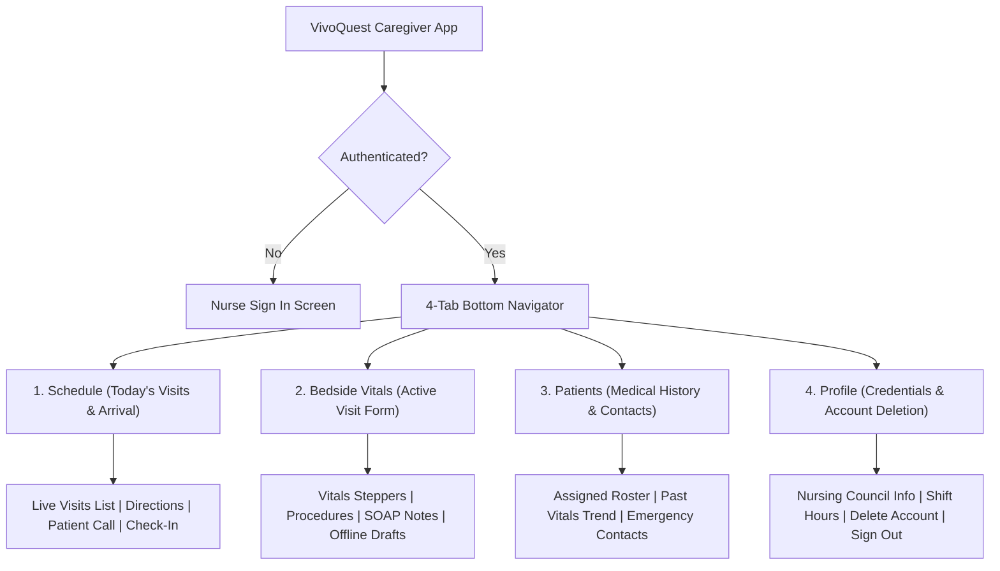

# VivoQuest Caregiver/Nurse App — Architectural & UI/UX Redesign Plan

**Application:** `apps/mobile-caregiver` (Configuring Package: `com.vivoquest.caregiver`)  
**Target Runtimes:** Android 14/15 (Google Play API 34/35) & iOS 17/18 (Apple App Store)  
**Framework:** Expo SDK 58, React Native 0.88.0, TypeScript 6.0.3  
**Status:** Read-Only Audit & Clinical Workflow Blueprint  
**Generated On:** October 30, 2026  

---

## 1. Executive Summary & Existing State Assessment

The VivoQuest Caregiver & Nurse Mobile Application (`apps/mobile-caregiver`) is designed for field healthcare professionals—licensed home care nurses, physiotherapists, and palliative caregivers—conducting daily home visits. The app enables practitioners to inspect assigned daily visit schedules, execute patient arrivals, document bedside vital signs, record nursing interventions, write clinical SOAP observations, review assigned patient medical histories, and track professional credentials.

Despite solid business logic and API integrations, the application has several technical, regulatory, and usability shortcomings:

1. **Missing Android & iOS Application Identifiers:** As discovered in the store audit, [`apps/mobile-caregiver/app.json`](file:///E:/VivoQuest%20Website/apps/mobile-caregiver/app.json) is missing both `android.package` and `ios.bundleIdentifier`. Without these, neither Google Play nor Apple App Store can generate or accept release builds.
2. **Text-Only Bottom Navigation:** The bottom navigation bar currently renders four text-only buttons without any iconography or notification badges:
   - `Schedule`
   - `Record Vitals`
   - `My Patients`
   - `Profile`
   This lacks visual affordance and makes one-handed clinical navigation difficult while wearing medical gloves or managing bedside equipment.
3. **Monolithic 3,107-Line Single File:** The entire UI, visit lifecycle management, bedside vitals form, and patient history exist in a single file ([`apps/mobile-caregiver/App.tsx`](file:///E:/VivoQuest%20Website/apps/mobile-caregiver/App.tsx)).
4. **Vulnerability to Offline Bedside Data Loss:** When documenting bedside vitals in patient homes with weak or zero cellular reception, submitting the form without an offline draft queue can result in network timeout errors and catastrophic clinical data loss.
5. **Missing Account Deletion & Disclaimers:** Lacks in-app account deletion (violating Apple Guideline 5.1.1v) and clinical responsibility disclaimers.

---

## 2. Feature-by-Feature Implementation Status

| Clinical Feature / Capability | Location in Codebase | Implementation Status | Finding & Evidence | Required Action in Redesign |
| :--- | :--- | :--- | :--- | :--- |
| **Caregiver Authentication** | [`apps/mobile-caregiver/src/components/LoginView.tsx`](file:///E:/VivoQuest%20Website/apps/mobile-caregiver/src/components/LoginView.tsx)<br>[`apps/mobile-caregiver/src/services/authStorage.ts`](file:///E:/VivoQuest%20Website/apps/mobile-caregiver/src/services/authStorage.ts) | `[Implemented]` | Hardware-backed JWT storage using `expo-secure-store`. Auto-logs out on token expiration (401). | Retain secure enclave storage; add clinical session timeout warning. |
| **Store Identifiers & Permissions** | [`apps/mobile-caregiver/app.json`](file:///E:/VivoQuest%20Website/apps/mobile-caregiver/app.json) | `[Missing]` | Missing `android.package` (`com.vivoquest.caregiver`), `ios.bundleIdentifier`, and camera/location purpose strings. | **CRITICAL:** Populate package identifiers and `Info.plist` usage descriptions in Phase 2. |
| **Visit Schedule & Dispatch** | [`apps/mobile-caregiver/App.tsx:711-995`](file:///E:/VivoQuest%20Website/apps/mobile-caregiver/App.tsx#L711-L995) | `[Implemented]` | Lists today’s scheduled visits, patient address, phone, arrival status, and reschedule requests. | Add live status chips (`en_route`, `arrived`, `in_progress`, `completed`) and map routing shortcut. |
| **Bottom Navigation Bar** | [`apps/mobile-caregiver/App.tsx:1675-1701`](file:///E:/VivoQuest%20Website/apps/mobile-caregiver/App.tsx#L1675-L1701) | `[Partially Implemented]` | Text-only tab items with no icons and no active visit badges. | Replace with 4-tab bar featuring `@expo/vector-icons` and pending visit badge count. |
| **Bedside Vitals Recording** | [`apps/mobile-caregiver/App.tsx:1039-1155`](file:///E:/VivoQuest%20Website/apps/mobile-caregiver/App.tsx#L1039-L1155) | `[Implemented]` | Numeric inputs for BP, Pulse, SpO2, Temp, Glucose, Pain score, Respiratory rate. | Add clinical abnormal range highlights (e.g., SpO2 < 90% turns red) and fast stepper controls. |
| **Procedures & Interventions** | [`apps/mobile-caregiver/App.tsx:1158-1181`](file:///E:/VivoQuest%20Website/apps/mobile-caregiver/App.tsx#L1158-L1181) | `[Implemented]` | Checklist for catheter inspection, nebulization, medication, pressure sore prevention. | Retain checklist; add "Add Custom Intervention" input. |
| **Clinical Notes & Observations** | [`apps/mobile-caregiver/App.tsx:1184-1200`](file:///E:/VivoQuest%20Website/apps/mobile-caregiver/App.tsx#L1184-L1200) | `[Implemented]` | Multiline text inputs for nursing notes and clinical recommendations. | Add quick clinical note templates (e.g., "Patient stable, vitals within baseline"). |
| **Offline Bedside Draft Caching** | Bedside Connectivity Requirement | `[Missing]` | Form state is lost if submission fails due to zero cellular signal. | Auto-save form progress to `@react-native-async-storage/async-storage` every 3 seconds. |
| **Patient Directory & History** | [`apps/mobile-caregiver/App.tsx:1300-1379`](file:///E:/VivoQuest%20Website/apps/mobile-caregiver/App.tsx#L1300-L1379) | `[Implemented]` | Lists assigned patients, medical condition summaries, emergency contacts. | Add patient search bar and past visit vitals trend charts. |
| **Caregiver Professional Profile** | [`apps/mobile-caregiver/App.tsx:1380-1670`](file:///E:/VivoQuest%20Website/apps/mobile-caregiver/App.tsx#L1380-L1670) | `[Implemented]` | Displays nursing council registration, qualifications, shift statistics, and logout. | Add credentials upload status badge and DPDP privacy settings. |
| **In-App Account Deletion** | Apple Guideline 5.1.1(v) | `[Missing]` | No option in Profile to request professional profile deactivation and data deletion. | **CRITICAL:** Add "Deactivate Profile / Delete Account" button in Profile tab. |
| **Android Back Handler** | Android UX standard | `[Missing]` | Hardware back button exits app abruptly during visit documentation. | Implement `BackHandler` with "Discard unsaved clinical documentation?" confirmation dialog. |

---

## 3. Bedside Ergonomics & Clinical Usability Upgrades

Field nurses often record vitals in high-stress home environments while wearing nitrile gloves or managing bedside medical equipment. The redesign introduces four clinical ergonomics improvements:

### 3.1 Abnormal Vitals Triage & Visual Highlighting

To prevent clinical charting errors and immediately flag unstable patients:
- **Oxygen Saturation (SpO2):**
  - Normal (>= 95%): Deep slate/neutral display.
  - Borderline (90–94%): Amber pill alert (*Mild Hypoxemia*).
  - Critical (< 90%): Flashing crimson banner (*Critical Hypoxemia — Doctor Escalation Recommended*).
- **Blood Pressure (Systolic / Diastolic):**
  - Normal (< 120/80): Neutral display.
  - Hypertensive Crisis (>= 180 / >= 120): Immediate red alert banner.
- **Blood Glucose:**
  - Hypoglycemia (< 70 mg/dL): Red alert (*Risk of Hypoglycemic Episode*).
  - Hyperglycemia (> 250 mg/dL): Amber alert.

### 3.2 Offline Bedside Resilience (Zero Data Loss)

To survive patient homes with thick concrete walls or zero cellular connectivity:
1. Every keystroke and checkbox selection in the Bedside Vitals form auto-saves to local storage (`@react-native-async-storage/async-storage`) using key `draft_vitals_visit_${visitId}`.
2. If the nurse submits while offline, the app captures the submission, marks it as `pending_sync`, displays a comforting banner (*"Report saved offline on device — will automatically upload once signal returns"*), and marks the visit locally as complete.
3. A background sync listener automatically pushes pending visit reports upon network reconnection (`NetInfo`).

### 3.3 Enhanced 4-Tab Navigation with Visual Badges



- **Schedule (`calendar-outline`):** Displays a red badge with the number of pending visits today (e.g., `3`).
- **Bedside Vitals (`pulse-outline`):** Glowing indicator when a patient visit is currently `in_progress`.
- **Patients (`people-outline`):** Directory of assigned long-term care patients.
- **Profile (`person-outline`):** Credentials, verification status, and account deletion.

---

## 4. Modular Code Refactoring Plan for Phase 2

To decompose the 3,107-line [`apps/mobile-caregiver/App.tsx`](file:///E:/VivoQuest%20Website/apps/mobile-caregiver/App.tsx), the codebase will be partitioned into clean, single-responsibility modules:

```
apps/mobile-caregiver/
├── src/
│   ├── components/
│   │   ├── AbnormalVitalBanner.tsx         (New: Clinical triage indicator)
│   │   ├── BedsideVitalsForm.tsx           (Extracted from App.tsx:1039-1215)
│   │   ├── ClinicalProcedureChecklist.tsx  (Extracted from App.tsx:1158-1181)
│   │   ├── LoginView.tsx                   (Existing, retain)
│   │   ├── RescheduleModal.tsx             (Existing, modularized)
│   │   └── VisitCard.tsx                   (Extracted from App.tsx:711-995)
│   ├── hooks/
│   │   ├── useAndroidBackHandler.ts        (New: Safe back button navigation)
│   │   └── useOfflineDraft.ts              (New: Auto-saves vitals form state)
│   ├── navigation/
│   │   ├── AppNavigator.tsx                (New: 4-tab container with badges)
│   │   └── TabBar.tsx                      (New: Vector icon bottom navigation)
│   ├── screens/
│   │   ├── BedsideVitalsScreen.tsx         (Extracted active visit workspace)
│   │   ├── PatientsScreen.tsx              (Extracted from App.tsx:1300-1379)
│   │   ├── ProfileScreen.tsx               (Extracted from App.tsx:1380-1670)
│   │   └── ScheduleScreen.tsx              (Extracted from App.tsx:711-995)
│   ├── services/
│   │   ├── apiClient.ts                    (Existing, retain)
│   │   └── authStorage.ts                  (Existing, retain)
│   └── types/
│       └── index.ts                        (Existing, expand)
└── App.tsx                                 (Lean root bootstrap < 100 lines)
```

---

## 5. Implementation Readiness & Risk Mitigation

- **Zero API Contract Modifications:** The redesign leverages existing `FieldVisit` schemas, `caregiverApi.recordClinicalDocumentation`, and `caregiverApi.updateVisitStatus` without any breaking changes.
- **Immediate Store Clearance:** Adding `android.package: "com.vivoquest.caregiver"` and `ios.bundleIdentifier: "com.vivoquest.caregiver"` in `app.json` resolves the primary build blocker immediately in Phase 2.
- **High Practitioner Satisfaction:** The combination of vector iconography, bedside offline autosave, and abnormal vital alerts transforms the app from a basic form into a robust clinical tool.

