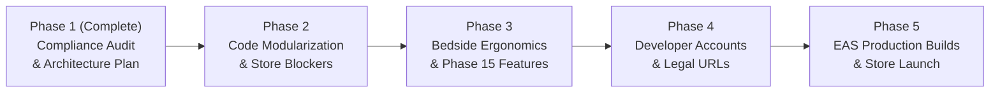

# VivoQuest — Mobile Release Readiness Checklist

**Applications:** VivoQuest Patient App (`apps/mobile-patient`) & Caregiver App (`apps/mobile-caregiver`)  
**Target Stores:** Google Play Store & Apple App Store  
**Audit Date:** October 30, 2026  
**Status:** Pre-Release Compliance & Verification Checklist  

---

## 1. Release Readiness Summary Matrix

This pre-flight checklist classifies every technical, regulatory, design, and release prerequisite required before VivoQuest can submit its mobile applications to Google Play and the Apple App Store.

| Readiness Category | Total Items | Implemented | Partially Implemented | Missing | External Config | Business / Legal |
| :--- | :---: | :---: | :---: | :---: | :---: | :---: |
| **1. Application Configuration & Build** | 6 | 3 | 0 | 1 | 2 | 0 |
| **2. App Store Policy Compliance (Both)** | 5 | 1 | 1 | 2 | 0 | 1 |
| **3. Google Play Specific Prerequisites** | 5 | 2 | 1 | 1 | 1 | 0 |
| **4. Apple App Store Specific Prerequisites** | 5 | 1 | 0 | 2 | 1 | 1 |
| **5. Health Data & Privacy (DPDP / ABDM)** | 5 | 2 | 1 | 1 | 0 | 1 |
| **6. UI/UX Ergonomics & Native Quality** | 5 | 2 | 1 | 2 | 0 | 0 |
| **7. Store Console & Developer Accounts** | 5 | 0 | 0 | 0 | 3 | 2 |
| **Total** | **36** | **11** | **4** | **9** | **7** | **5** |

---

## 2. Detailed Checklist by Release Track

### Track 1: Application Configuration & Native Manifests

| # | Item Description | Relevant File / Artifact | Current State | Status | Phase |
| :---: | :--- | :--- | :--- | :--- | :---: |
| 1.1 | **Patient App Identifier** | [`apps/mobile-patient/app.json`](file:///E:/VivoQuest%20Website/apps/mobile-patient/app.json) | `com.vivoquest.patient` configured for Android | `[Implemented]` | — |
| 1.2 | **Caregiver App Identifiers** | [`apps/mobile-caregiver/app.json`](file:///E:/VivoQuest%20Website/apps/mobile-caregiver/app.json) | Missing `android.package` and `ios.bundleIdentifier` | `[Missing]` | Phase 2 |
| 1.3 | **Target Android API Level 34/35** | Expo SDK 58 runtime | Expo SDK 58 defaults to Android 14/15 (API 34/35) | `[Implemented]` | — |
| 1.4 | **App Icons & Splash Screens** | `assets/` in both apps | High-resolution adaptive icons and splash PNGs exist | `[Implemented]` | — |
| 1.5 | **iOS Permission Purpose Strings** | `app.json` (`ios.infoPlist`) | Missing `NSCameraUsageDescription`, `NSPhotoLibraryUsageDescription`, `NSLocationWhenInUseUsageDescription` | `[Missing]` | Phase 2 |
| 1.6 | **EAS Build Configuration (`eas.json`)** | Project root / apps | Not yet initialized (`eas build` configuration) | `[External Config]` | Phase 4 |

---

### Track 2: Core Store Policy Compliance (Universal)

| # | Item Description | Store Guideline Reference | Current State | Status | Phase |
| :---: | :--- | :--- | :--- | :--- | :---: |
| 2.1 | **In-App Account Deletion** | Apple 5.1.1(v) & Google Play User Data | Missing in both apps; backend only supports admin deletion | `[Missing]` | Phase 2 |
| 2.2 | **Public Deletion Request Webpage** | Google Play Data Safety | Missing URL (`https://vivoquest.in/account-deletion`) | `[Missing]` | Phase 2 |
| 2.3 | **Medical Emergency Disclaimers** | Apple 1.4.1 & Google Play Health Policy | Missing statutory clinical warning disclaimers in UI | `[Missing]` | Phase 2 |
| 2.4 | **Payment Policy Exemption Justification** | Apple 3.1.3(e)/3.1.5(a) & Play Billing Policy | Documented: Real-world nursing labor and physical DME delivery are exempt from store 15–30% IAP commissions | `[Implemented]` | — |
| 2.5 | **Public Privacy Policy URL** | Apple 5.1.1 & Google Play Policy | Web privacy policy exists; needs explicit mobile health disclosures | `[Partially Implemented]` | Phase 4 |

---

### Track 3: Google Play Store Requirements

| # | Item Description | Play Policy Reference | Current State | Status | Phase |
| :---: | :--- | :--- | :--- | :--- | :---: |
| 3.1 | **Health Apps Declaration** | Play Console Health Apps Policy | Needs category selection (*Care management / Home care*) | `[External Config]` | Phase 4 |
| 3.2 | **Data Safety Section Disclosures** | Play Console Data Safety | Audit completed: Personal info, Health/Vitals, Encryption, Deletion | `[Implemented]` | Phase 4 |
| 3.3 | **Target API Level Compliance** | Google Play Aug 2024+ Mandate | Verified: Expo SDK 58 compiles to API 34+ | `[Implemented]` | — |
| 3.4 | **Android App Bundle (AAB)** | Play Delivery Requirement | Continuous Native Generation (CNG) supports AAB output | `[Partially Implemented]` | Phase 5 |
| 3.5 | **20-Tester Closed Testing Exemption** | Google Play Testing Policy | Required for Personal accounts; exempt if Organization account is used | `[Business / Legal]` | Phase 4 |

---

### Track 4: Apple App Store Requirements

| # | Item Description | App Store Review Reference | Current State | Status | Phase |
| :---: | :--- | :--- | :--- | :--- | :---: |
| 4.1 | **Apple Developer Organization Account** | App Store Enrollment Policy | Medical apps must be published under a legal entity, not an individual; requires D-U-N-S number | `[Business / Legal]` | Phase 4 |
| 4.2 | **App Privacy Details (Privacy Nutrition Labels)** | App Store Connect Requirement | Audit completed: Data Linked to User (Health, Contact Info, User Content) | `[Implemented]` | Phase 4 |
| 4.3 | **Guideline 2.1 (App Completeness)** | App Store Review Guideline 2.1 | All placeholder buttons and dead links must be resolved prior to submission | `[Partially Implemented]` | Phase 2 |
| 4.4 | **Reviewer Demo Credentials** | App Review Requirement | Dedicated demo patient and demo nurse accounts with pre-loaded mock visits and orders | `[Missing]` | Phase 4 |
| 4.5 | **TestFlight Internal / External Distribution** | iOS Quality Assurance | EAS build credentials and provisioning profiles required | `[External Config]` | Phase 5 |

---

### Track 5: Health Data, Privacy & Security (DPDP Act & ABDM)

| # | Item Description | Regulatory Standard | Current State | Status | Phase |
| :---: | :--- | :--- | :--- | :--- | :---: |
| 5.1 | **Hardware-Backed Cryptographic Token Storage** | OWASP Mobile Top 10 | Implemented: `expo-secure-store` with Android Keystore / iOS Keychain | `[Implemented]` | — |
| 5.2 | **Transport Security (TLS 1.3 / HTTPS)** | DPDP Act / Apple ATS | Production endpoints enforce HTTPS; no cleartext permitted | `[Implemented]` | — |
| 5.3 | **DPDP Notice & Explicit Consent Screen** | DPDP Act 2023 Section 5 & 6 | Missing in mobile registration/login flow | `[Missing]` | Phase 2 |
| 5.4 | **Role-Based Access Control on Health Files** | ABDM / Clinical Governance | Tiered access (`PATIENT_CLINICIAN_CONFIDENTIAL`) in backend | `[Implemented]` | — |
| 5.5 | **Data Protection Officer / Grievance Contact** | DPDP Act 2023 Section 8 | Published on website; missing direct contact button in mobile Profile | `[Partially Implemented]` | Phase 2 |

---

### Track 6: UI/UX Ergonomics & Native Quality

| # | Item Description | Design Standard | Current State | Status | Phase |
| :---: | :--- | :--- | :--- | :--- | :---: |
| 6.1 | **Bottom Navigation Optimization** | Material Design / Apple HIG | Patient has 7 emoji tabs; Caregiver has 4 text-only tabs. Needs vector icon standard | `[Partially Implemented]` | Phase 2 |
| 6.2 | **Android Back Button (`BackHandler`)** | Android Core Quality Guidelines | Missing in both apps; pressing back exits app abruptly | `[Missing]` | Phase 2 |
| 6.3 | **Elderly Accessibility & Touch Targets** | WCAG 2.1 AA | Touch targets need to be standardized to >= 52dp with high-contrast text | `[Partially Implemented]` | Phase 2 |
| 6.4 | **Bedside Offline Draft Auto-Saving** | Clinical Field Usability | Missing; loss of cellular connectivity can drop bedside vitals inputs | `[Missing]` | Phase 3 |
| 6.5 | **Abnormal Vitals Clinical Alerts** | Clinical Decision Support | Missing visual warnings for severe hypertension, hypoxemia, fever | `[Missing]` | Phase 3 |

---

### Track 7: Developer Consoles & External Infrastructure

| # | Item Description | Owner / Authority | Required Action | Status | Phase |
| :---: | :--- | :--- | :--- | :--- | :---: |
| 7.1 | **Google Play Console Organization Account** | VivoQuest Business Entity | Register organization account; complete identity verification | `[Business / Legal]` | Phase 4 |
| 7.2 | **Apple Developer Program Organization Account** | VivoQuest Business Entity | Obtain D-U-N-S number from Dun & Bradstreet; enroll entity | `[Business / Legal]` | Phase 4 |
| 7.3 | **Public Web Deletion Portal** | VivoQuest Web Platform | Deploy `https://vivoquest.in/account-deletion` | `[External Config]` | Phase 4 |
| 7.4 | **Privacy Policy Web Update** | VivoQuest Legal Team | Add mobile health disclosures & Grievance Officer details | `[Business / Legal]` | Phase 4 |
| 7.5 | **Expo Application Services (EAS) Account** | VivoQuest DevOps | Configure EAS project IDs and remote build signing certificates | `[External Config]` | Phase 4 |

---

## 3. Phased Implementation Roadmap from Phase 2 to Store Launch

### Phase 2: Code Modularization & Critical Store Blockers
1. Deconstruct monolithic `App.tsx` files in both apps into clean, testable modular screens.
2. Configure missing `android.package` and `ios.bundleIdentifier` in `apps/mobile-caregiver/app.json`.
3. Add iOS usage description strings (`NSCameraUsageDescription`, `NSLocationWhenInUseUsageDescription`).
4. Implement self-service **Account Deletion** flow in Profile screens and backend `DELETE /api/v1/auth/delete-account`.
5. Insert standard **Medical Emergency Disclaimers** across home and vitals views.
6. Refactor bottom navigation to standard 5-tab (Patient) and 4-tab (Caregiver) layouts using `@expo/vector-icons`.
7. Implement React Native `BackHandler` hooks across both applications.

### Phase 3: Bedside Ergonomics & Phase 15 Delivery Workflows
1. Build offline draft auto-save hook using `@react-native-async-storage/async-storage` for the Bedside Vitals form.
2. Add visual abnormal vital triage alerts (SpO2 < 90%, Hypertensive Crisis).
3. Implement Customer Delivery OTP display card in Patient App for active equipment orders.
4. Implement Delivery Ratings & Product Reviews modal in Patient App for delivered orders.
5. Implement Returns & Product Complaints filing modal in Patient App.

### Phase 4: Legal Infrastructure & Developer Consoles
1. Finalize Google Play and Apple Developer Organization enrollments using VivoQuest’s legal entity and D-U-N-S number.
2. Deploy public account deletion landing page at `https://vivoquest.in/account-deletion`.
3. Update Privacy Policy URL with mobile health declarations and appointed Grievance Officer contact details.
4. Initialize `eas.json` with production and preview build profiles.
5. Create dedicated App Reviewer test accounts with pre-populated test data.

### Phase 5: Production EAS Builds & Store Submissions
1. Run `eas build --platform android --profile production` to produce optimized Android App Bundles (.aab).
2. Run `eas build --platform ios --profile production` to produce signed iOS binaries.
3. Submit Patient App and Caregiver App to Google Play Console Closed Testing track.
4. Submit builds to Apple TestFlight for internal clinician validation.
5. Complete Google Play Health Apps Declaration and Apple App Privacy questionnaire.
6. Submit for official App Store and Google Play Production Review.

