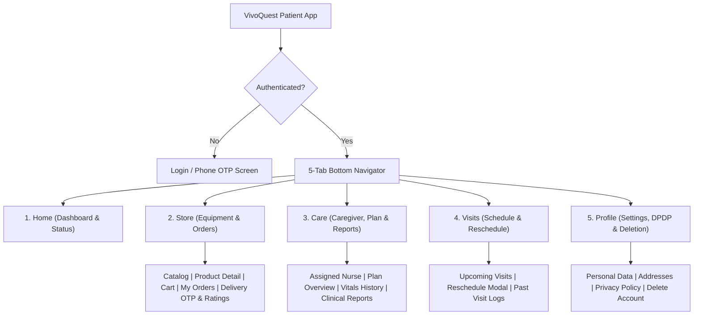

# VivoQuest Patient App — Architectural & UI/UX Redesign Plan

**Application:** `apps/mobile-patient` (`com.vivoquest.patient`)  
**Target Runtimes:** Android 14/15 (Google Play API 34/35) & iOS 17/18 (Apple App Store)  
**Framework:** Expo SDK 58, React Native 0.88.0, TypeScript 6.0.3  
**Status:** Read-Only Audit & Architectural Blueprint  
**Generated On:** October 30, 2026  

---

## 1. Executive Summary & Existing State Assessment

The existing VivoQuest Patient Mobile App (`apps/mobile-patient`) is an extensive application that supports user authentication, care subscription tracking, daily clinical reports, caregiver details, visit scheduling and rescheduling, and an integrated medical equipment eCommerce store with cart, checkout, and order history.

However, the application currently suffers from significant architectural and UI/UX deficiencies that prevent a seamless user experience and violate Google Play and Apple App Store review guidelines:

1. **Monolithic Single-File Architecture:** The primary application logic, views, modals, and navigation reside inside a single 4,258-line file ([`apps/mobile-patient/App.tsx`](file:///E:/VivoQuest%20Website/apps/mobile-patient/App.tsx)). This creates high cognitive complexity, prevents isolated screen testing, and increases regression risks.
2. **Crowded 7-Tab Bottom Navigation:** The bottom navigation bar currently renders seven concurrent tabs with emoji icons:
   - `🏠 Home`
   - `🩺 Caregiver`
   - `📅 Visits`
   - `📋 Reports`
   - `🛡️ Plans`
   - `🛒 Equipment`
   - `👤 Profile`
   This violates Google Material Design and Apple Human Interface Guidelines (both of which mandate 3 to 5 primary destinations maximum) and results in cramped, difficult-to-tap targets on standard smartphone displays.
3. **Missing Hardware Back Navigation:** The app does not register a React Native `BackHandler` listener. On Android devices, pressing the physical or gesture back button exits the app abruptly rather than closing active modals, returning to the previous subview, or resetting to the Home tab.
4. **Missing App Store Requisite Features:** The app lacks an in-app Account Deletion flow (Apple Guideline 5.1.1v blocker), statutory medical emergency disclaimers (Apple Guideline 1.4.1), and Phase 15 customer delivery verification cards (Customer Delivery OTP display and delivery rating modals).

---

## 2. Feature-by-Feature Implementation Status

| Feature / Capability | Location in Codebase | Implementation Status | Finding & Audit Evidence | Required Action in Redesign |
| :--- | :--- | :--- | :--- | :--- |
| **Authentication & Session** | [`apps/mobile-patient/src/components/LoginView.tsx`](file:///E:/VivoQuest%20Website/apps/mobile-patient/src/components/LoginView.tsx)<br>[`apps/mobile-patient/src/services/authStorage.ts`](file:///E:/VivoQuest%20Website/apps/mobile-patient/src/services/authStorage.ts) | `[Implemented]` | Hardware-encrypted JWT storage via `expo-secure-store` with Android Keystore/iOS Keychain fallback. | Preserve secure token flow; add DPDP consent notice. |
| **Bottom Navigation Bar** | [`apps/mobile-patient/App.tsx:2168-2220`](file:///E:/VivoQuest%20Website/apps/mobile-patient/App.tsx#L2168-L2220) | `[Partially Implemented]` | 7 tabs with emoji icons (`🏠`, `🩺`, `📅`, etc.) causing horizontal crowding and clipping. | Consolidate into standard 5-tab bar with `@expo/vector-icons`. |
| **Medical Store & Cart** | [`apps/mobile-patient/src/components/EquipmentStoreView.tsx`](file:///E:/VivoQuest%20Website/apps/mobile-patient/src/components/EquipmentStoreView.tsx)<br>[`apps/mobile-patient/src/components/CartCheckoutModal.tsx`](file:///E:/VivoQuest%20Website/apps/mobile-patient/src/components/CartCheckoutModal.tsx) | `[Implemented]` | Full catalog browsing, cart operations, delivery address input, Razorpay/UPI/COD payment selection. | Elevate to dedicated bottom tab ("Store") with search and filter enhancements. |
| **Order History & Tracking** | [`apps/mobile-patient/src/components/MyOrdersModal.tsx`](file:///E:/VivoQuest%20Website/apps/mobile-patient/src/components/MyOrdersModal.tsx) | `[Partially Implemented]` | Modal displays past equipment orders, status pills, and item lists. | Integrate into Store view; add delivery tracking timeline. |
| **Customer Delivery OTP** | Phase 15 Requirement | `[Missing]` | Order details lack prominent customer delivery OTP display card for off-app delivery confirmation. | Display secure 6-digit OTP card on active orders: *"Share this OTP with your delivery provider only when equipment is delivered."* |
| **Ratings & Feedback** | Phase 15 Requirement | `[Missing]` | Delivered orders lack modal to submit delivery ratings and product reviews. | Add 1–5 star rating modal with delivery partner feedback and product review text. |
| **Returns & Complaints** | Phase 15 Requirement | `[Missing]` | Delivered orders lack action to report defects, initiate replacement, or file complaints. | Add "Request Return / Report Issue" modal wiring to `ProductComplaint` backend API. |
| **Caregiver Details & Plans** | [`apps/mobile-patient/App.tsx:1259-1505`](file:///E:/VivoQuest%20Website/apps/mobile-patient/App.tsx#L1259-L1505) | `[Implemented]` | Displays assigned nurse photo, qualifications, emergency call button, and care plan tier. | Merge into unified "Care" tab alongside clinical reports. |
| **Visit Scheduling** | [`apps/mobile-patient/App.tsx:1508-1830`](file:///E:/VivoQuest%20Website/apps/mobile-patient/App.tsx#L1508-L1830) | `[Implemented]` | Visit calendar, status chips, slot selection, and reschedule modal. | Retain in dedicated "Visits" tab with enhanced time-slot picker. |
| **Clinical Reports & Vitals** | [`apps/mobile-patient/App.tsx:1834-1910`](file:///E:/VivoQuest%20Website/apps/mobile-patient/App.tsx#L1834-L1910) | `[Partially Implemented]` | Displays historical bedside vitals and notes; lacks file attachment viewer. | Standardize vital metric cards (BP, SpO2, Pulse) with abnormal threshold alerts. |
| **In-App Account Deletion** | Apple Guideline 5.1.1(v) | `[Missing]` | No option in Profile to request self-service account deletion and data erasure. | **CRITICAL:** Add "Delete Account" button with 2FA confirmation in Profile tab. |
| **Medical Emergency Disclaimer** | Apple Guideline 1.4.1 | `[Missing]` | No persistent clinical disclaimer warning patients that app is not for emergency triage. | Add persistent emergency banner on Home tab and footer of Care tab. |
| **Android Back Handler** | Android UX standard | `[Missing]` | Hardware back button immediately terminates the application. | Add `BackHandler` hook to handle modal dismiss and tab navigation gracefully. |

---

## 3. Target Navigation Architecture: The 5-Tab Ergonomic Standard

To eliminate visual clutter, satisfy Apple/Google human interface guidelines, and optimize usability for elderly patients and family members, the navigation is restructured from 7 tabs to **5 core tabs**:



### 3.1 Tab Breakdown & Iconography (`@expo/vector-icons`)

1. **Tab 1: Home (`home-outline` / `home`)**
   - Emergency banner at top: *"Emergency? Call 112 / 108. VivoQuest is a home care coordination platform, not an emergency triage service."*
   - Active Care Card (Today's upcoming visit status, assigned nurse name, arrival countdown).
   - Active Equipment Order Card (Live dispatch status, "View Delivery OTP" button).
   - Quick Action Tiles: *Request Equipment*, *Book Home Visit*, *Call Nurse*, *View Vitals*.
2. **Tab 2: Store (`bag-handle-outline` / `bag-handle`)**
   - Merges current `Equipment` tab and `MyOrdersModal`.
   - Header with search bar, category chips (*Respiratory, Mobility, Hospital Beds, Diagnostics*), and Cart badge counter.
   - Sub-tab or toggle: `Catalog` vs. `My Orders`.
   - **My Orders Section:**
     - Includes Order Card with live status (`confirmed`, `dispatched`, `out_for_delivery`, `delivered`).
     - When `out_for_delivery`: Highlights large **"Your Delivery OTP: 492815"** card with instructions: *"Share only upon physical inspection and delivery."*
     - When `delivered`: Displays **"Rate Delivery & Review Product"** button triggering Phase 15 modal.
     - "Request Return / Report Defect" button for completed deliveries.
3. **Tab 3: Care (`heart-pulse-outline` / `heart-pulse`)**
   - Merges current `Caregiver`, `Plans`, and `Reports` tabs into a coherent healthcare hub.
   - **Section A: Assigned Caregiver:** Professional photo, qualification badges, emergency contact shortcut.
   - **Section B: Active Care Plan:** Subscription tier (*Comprehensive Elder Care*), remaining visits counter, renewal button.
   - **Section C: Vitals Surveillance:** Latest recorded Blood Pressure, SpO2, Pulse, Blood Glucose with color-coded normal/abnormal ranges.
   - **Section D: Daily Clinical Documentation:** Signed bedside visit reports, procedure checklist summaries, and nursing notes.
4. **Tab 4: Visits (`calendar-outline` / `calendar`)**
   - Calendar schedule view showing upcoming and past field visits.
   - Visit detail modal with time-slot selection (`08:00 AM - 10:00 AM`, etc.).
   - Reschedule request modal wiring to `VisitRescheduleRequest` backend API.
5. **Tab 5: Profile (`person-outline` / `person`)**
   - Patient PII: Name, phone, email, date of birth, emergency contact.
   - Saved Delivery Addresses with GPS pin validation.
   - Regulatory & Legal:
     - View Privacy Notice & DPDP Act 2023 safeguards.
     - View Terms of Service.
     - Contact Data Protection & Grievance Officer.
   - **Critical Account Management:**
     - Prominent red action: **"Delete Account & Personal Data"** (triggers 2FA OTP modal).
     - Sign Out / Conclude Session.

---

## 4. Elderly & Accessibility Design System (Ergonomics)

Patients and elderly caregivers are primary users of this application. The redesign enforces strict accessibility standards:

- **Touch Targets:** Minimum touch target height of `52dp` for all buttons, tab items, and form inputs (exceeding Apple's 44dp and Android's 48dp minimums).
- **Typography Scale:**
  - Header: `24sp` / `28sp` bold (`#0f172a`)
  - Subheader: `18sp` semi-bold (`#1e293b`)
  - Body text: `16sp` regular (`#334155`) with high line-height (`24sp`)
  - Captions/Hints: Minimum `13sp` (`#64748b`) — zero illegible microscopic text.
- **Color Contrast:** Strict WCAG 2.1 AA compliance:
  - Primary Brand: `#0f766e` (Deep Teal) / `#0d9488` (Teal) on white backgrounds (contrast ratio > 4.5:1).
  - Backgrounds: Neutral clean whites (`#ffffff`) and soft slates (`#f8fafc`).
  - Alert / Emergency: Crimson (`#b91c1c`) for emergency banners and abnormal vital alerts.
- **No Reliance on Emojis:** Replace all OS-dependent emojis with crisp SVG vector icons (`@expo/vector-icons/Ionicons`).

---

## 5. Modular Code Refactoring Plan for Phase 2

To dismantle the 4,258-line monolithic [`apps/mobile-patient/App.tsx`](file:///E:/VivoQuest%20Website/apps/mobile-patient/App.tsx), the codebase will be refactored into the following clean modular hierarchy:

```
apps/mobile-patient/
├── src/
│   ├── components/
│   │   ├── CartCheckoutModal.tsx           (Existing, retain)
│   │   ├── DeliveryOtpCard.tsx             (New: Phase 15 OTP display)
│   │   ├── DeliveryRatingModal.tsx         (New: Phase 15 Ratings & Reviews)
│   │   ├── EquipmentStoreView.tsx          (Existing, modularized)
│   │   ├── LoginView.tsx                   (Existing, retain)
│   │   ├── MedicalDisclaimerBanner.tsx     (New: Apple 1.4.1 compliance)
│   │   ├── MyOrdersModal.tsx               (Existing, enhanced)
│   │   ├── OrderConfirmationModal.tsx      (Existing, retain)
│   │   ├── ProductDetailModal.tsx          (Existing, retain)
│   │   └── ReturnRequestModal.tsx          (New: Phase 15 Returns/Complaints)
│   ├── hooks/
│   │   └── useAndroidBackHandler.ts        (New: Hardware back navigation)
│   ├── navigation/
│   │   ├── AppNavigator.tsx                (New: 5-tab root container)
│   │   └── TabBar.tsx                      (New: Vector icon bottom bar)
│   ├── screens/
│   │   ├── CareScreen.tsx                  (Extracted from App.tsx:1259-1505)
│   │   ├── HomeScreen.tsx                  (Extracted from App.tsx:1019-1250)
│   │   ├── ProfileScreen.tsx               (Extracted from App.tsx:2096-2165)
│   │   ├── StoreScreen.tsx                 (Extracted from App.tsx:971-1018)
│   │   └── VisitsScreen.tsx                (Extracted from App.tsx:1508-1830)
│   ├── services/
│   │   ├── apiClient.ts                    (Existing, retain)
│   │   └── authStorage.ts                  (Existing, retain)
│   └── types/
│       └── index.ts                        (Existing, expand)
└── App.tsx                                 (Lean root bootstrap < 100 lines)
```

---

## 6. Implementation Readiness & Risk Mitigation

- **Preservation of Existing State & Contracts:** The refactoring touches zero backend endpoints and strictly reuses existing types in `src/types/index.ts` and API methods in `src/services/apiClient.ts`.
- **Zero Build Disruption:** The modularization can be executed incrementally, testing each screen component in isolation while keeping the app functional at every step.
- **Phase 2 Implementation Target:** Ready for execution immediately upon user approval.

