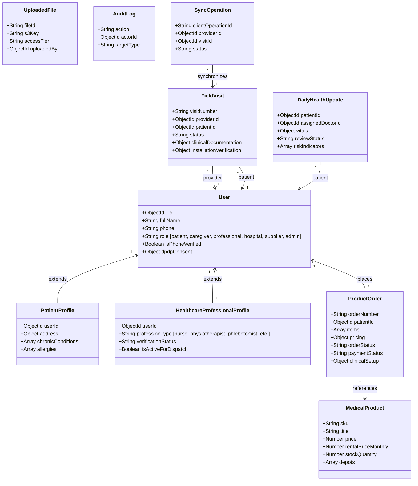
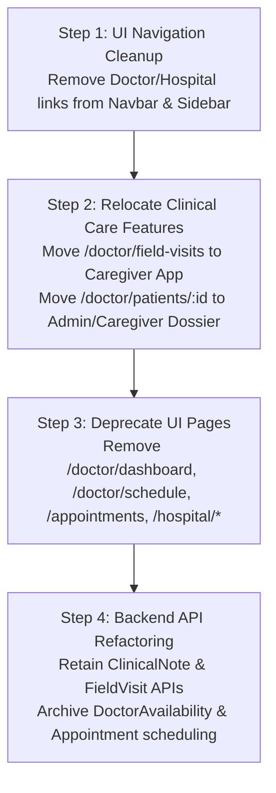
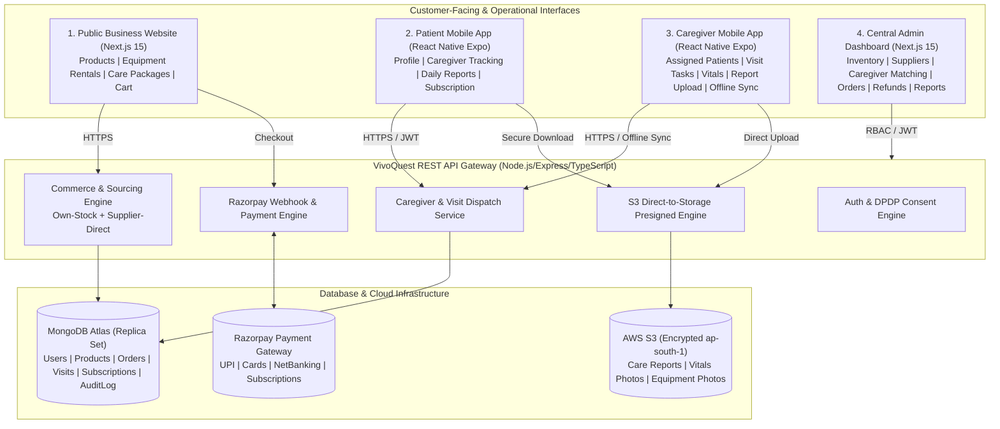
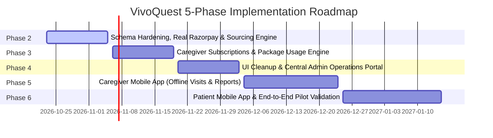

# VivoQuest Phase 1: Scope Cleanup & Architecture Audit Report

**Document Version:** 1.0.0  
**Audit Date:** October 22, 2026  
**Auditor:** Antigravity AI Engineering Team  
**Repository Location:** `E:\VivoQuest Website`  
**Git Remote:** `https://github.com/RajdipBankar-07/VivoQuest-_Palliative_Cancer.git` (`refs/heads/main`)  
**Status:** Audit Completed — Read-Only Inspection Phase  

---

## 1. Executive Summary

VivoQuest is transitioning from a multi-portal marketplace concept (which previously included independent doctor portals, hospital discharge dashboards, corporate wellness, and cricket-themed gamified habit tracking) to a **focused, closed-loop palliative and home healthcare operating model**.

### Approved Business Scope
The approved operational scope mandates:
1. **Public Business Website:** Catalog browsing of medical equipment and healthcare devices, dynamic pricing, rental availability, cart, and end-to-end checkout.
2. **Patient Mobile App:** Profile management, assigned caregiver tracking, subscription and care-package purchases, and authorized access to daily care reports.
3. **Caregiver Mobile App:** Assigned patient itineraries, clinical visit checklists, vital signs observation recording, daily care report uploads, equipment installation verification, and offline-capable synchronization.
4. **Central Admin Dashboard:** Business operations encompassing inventory management (own-stock and supplier-direct), supplier procurement, caregiver assignments, patient management, order fulfillment, payment processing, refund handling, and financial reporting.

### Out of Approved Scope
* Independent Doctor Dashboards and doctor-centric availability scheduling.
* Independent Hospital Dashboards and direct hospital discharge queueing.
* Doctor-patient teleconsultation and clinic appointment scheduling.
* Legacy cricket-themed health gamification, corporate wellness leagues, and creator monetisation.

### Core Audit Takeaways
* **No Mobile Application Exists:** Despite mentions in documentation (`docs/architecture.md`, `README.md`), no React Native, Expo, or Flutter code exists in the repository. Mobile clients must be built from the ground up.
* **Doctor & Hospital Code Contain Reusable Clinical Assets:** The `/doctor/field-visits` route contains an 88KB, fully-realized field clinician interface with offline queueing, vitals tracking, and equipment installation. The `ClinicalNote`, `DailyHealthUpdate`, and `FieldVisit` models are vital to caregiver documentation and patient history. These must **not** be deleted, but rather decoupled and repurposed.
* **Commerce is Partially Mocked:** While product catalog browsing, cart context, and order placement work against MongoDB, **Razorpay integration is entirely simulated**. No official Razorpay SDK is installed in `apps/api`, order IDs are generated as local dummy strings, and the frontend displays a test verification modal without invoking Razorpay Checkout.
* **High-Severity Security Gaps:**
  1. **Universal OTP Bypass:** `authService.ts` accepts *any* 6-digit OTP for any user in the database without environment gating, effectively disabling authentication for phone logins.
  2. **Confidential File Exposure:** In `storageService.ts`, any user with the `professional` role can download any confidential medical report (`PATIENT_CLINICIAN_CONFIDENTIAL`) across all patients without verifying caregiver assignment.
  3. **Hardcoded Auto-Logins:** Multiple frontend dashboard pages automatically authenticate using hardcoded phone numbers and default OTPs (`123456`) if an active session is missing.

---

## 2. Actual Project Structure

```
E:\VivoQuest Website\
├── .env.example                       # Root environment variable template
├── .gitignore                         # Git exclusion rules
├── package.json                       # Monorepo root package.json (npm workspaces: frontend, apps/api)
├── package-lock.json                  # Root dependency lockfile
├── README.md                          # Project documentation
├── run_all.bat                        # Windows one-click launcher for ports 3000, 4000, 8000
├── run_all.ps1                        # PowerShell variant launcher
├── stop_all.bat                       # Process terminator for ports 3000, 4000, 8000
├── push_to_github.bat                 # Automated git synchronization script
├── VivoQuest Tech Focus.pdf           # Project brief and clinical domain requirements
├── docs/                              # Project documentation
│   ├── architecture.md                # System architecture specification
│   ├── implementation-plan.md         # 8-week historical milestone plan
│   └── phase-1-architecture-audit.md  # This document
├── apps/
│   ├── api/                           # Node.js + Express + TypeScript REST API Gateway
│   │   ├── package.json               # Dependencies: express, mongoose, @aws-sdk, jsonwebtoken, zod
│   │   ├── tsconfig.json              # TypeScript compilation configuration
│   │   ├── dist/                      # Compiled JavaScript output
│   │   ├── src/
│   │   │   ├── app.ts                 # Express app initialization, CORS, middleware, routing
│   │   │   ├── server.ts              # Server bootstrap and MongoDB connection
│   │   │   ├── config/
│   │   │   │   ├── database.ts        # Mongoose connection lifecycle & status
│   │   │   │   └── environment.ts     # Zod-backed / dotenv configuration parser
│   │   │   ├── middleware/
│   │   │   │   ├── auth.ts            # JWT authentication & role-based access control
│   │   │   │   ├── errorHandler.ts    # Centralized AppError handling
│   │   │   │   ├── rateLimiter.ts     # express-rate-limit definitions
│   │   │   │   └── validate.ts        # Zod request validation wrapper
│   │   │   ├── models/                # 21 Mongoose schema definitions
│   │   │   │   ├── Appointment.ts
│   │   │   │   ├── AuditLog.ts
│   │   │   │   ├── Booking.ts
│   │   │   │   ├── ClinicalNote.ts
│   │   │   │   ├── DailyHealthUpdate.ts
│   │   │   │   ├── DoctorAvailability.ts
│   │   │   │   ├── FieldVisit.ts
│   │   │   │   ├── HealthcareProfessionalProfile.ts
│   │   │   │   ├── HealthcareService.ts
│   │   │   │   ├── HospitalProfile.ts
│   │   │   │   ├── HospitalReferral.ts
│   │   │   │   ├── MedicalProduct.ts
│   │   │   │   ├── NotificationLog.ts
│   │   │   │   ├── PatientProfile.ts
│   │   │   │   ├── ProductOrder.ts
│   │   │   │   ├── ProfessionalCredentials.ts
│   │   │   │   ├── ShoppingCart.ts
│   │   │   │   ├── SupportTicket.ts
│   │   │   │   ├── SyncOperation.ts
│   │   │   │   ├── UploadedFile.ts
│   │   │   │   ├── User.ts
│   │   │   │   └── index.ts
│   │   │   ├── routes/                # Express API Route handlers
│   │   │   │   ├── adminRoutes.ts
│   │   │   │   ├── aiRoutes.ts
│   │   │   │   ├── appointmentRoutes.ts
│   │   │   │   ├── authRoutes.ts
│   │   │   │   ├── bookingRoutes.ts
│   │   │   │   ├── doctorRoutes.ts
│   │   │   │   ├── fieldVisitRoutes.ts
│   │   │   │   ├── healthRoutes.ts
│   │   │   │   ├── hospitalRoutes.ts
│   │   │   │   ├── patientRoutes.ts
│   │   │   │   ├── productRoutes.ts
│   │   │   │   ├── serviceRoutes.ts
│   │   │   │   ├── uploadRoutes.ts
│   │   │   │   └── userRoutes.ts
│   │   │   └── services/              # Business logic layers
│   │   │       ├── adminService.ts
│   │   │       ├── aiCoordinationService.ts
│   │   │       ├── authService.ts
│   │   │       ├── clinicalRiskService.ts
│   │   │       ├── doctorSchedulingService.ts
│   │   │       ├── fieldOperationsService.ts
│   │   │       ├── hospitalReferralService.ts
│   │   │       ├── notificationService.ts
│   │   │       ├── paymentService.ts
│   │   │       ├── productCatalogService.ts
│   │   │       ├── serviceCatalogService.ts
│   │   │       └── storageService.ts
│   │   └── tests/                     # Node test runner suite (9 test suites)
│   └── ai-services/                   # Python 3.11 + FastAPI Clinical Bundling & Dispatch Engine
│       ├── requirements.txt           # fastapi, uvicorn, pydantic, httpx, pytest
│       ├── app/
│       │   ├── main.py                # FastAPI app mounting routers, CORS, exception handlers
│       │   ├── config.py              # Pydantic BaseSettings
│       │   ├── api/                   # FastAPI endpoints (health, bundling, matching, routing)
│       │   ├── schemas/               # Pydantic request/response schemas
│       │   └── services/              # Bundling heuristics, matching logic, haversine routing
│       └── tests/                     # Pytest suite
└── frontend/                          # Next.js 15 App Router Frontend
    ├── package.json                   # next, react 19, tailwindcss v4, lucide-react, framer-motion
    ├── next.config.mjs
    ├── tailwind.config.js
    ├── tsconfig.json
    └── src/
        ├── middleware.ts              # Next.js route protection & role redirection
        ├── context/
        │   └── CartContext.tsx        # React Context for medical product cart & persistence
        ├── lib/
        │   ├── api.ts                 # 2,180-line centralized API client connecting to port 4000
        │   └── offlineSync.ts         # IndexedDB synchronization queue for field visits
        ├── components/                # Shared UI design system components
        └── app/                       # Next.js App Router Pages (29 route folders)
            ├── page.tsx               # Public Homepage & Palliative Showcase (70KB)
            ├── products/              # Medical Equipment Store & Detail Views
            ├── checkout/              # Equipment Checkout & Installation Preferences
            ├── orders/                # Patient Order Tracking & Returns
            ├── dashboard/             # Patient Health Log & Care Plan Overview
            ├── admin/                 # Admin Operations Dashboard & Login
            ├── super-admin/           # Super Admin Governance Console
            ├── doctor/                # Doctor Dashboard, Schedule, Dossier & Field Visits
            ├── doctors/               # Public Doctor Directory & Booking Flow
            ├── appointments/          # Appointment Management & Rescheduling
            ├── hospital/              # Hospital Dashboard & Referral Management
            ├── clinical/              # Clinical Task Bundling & AI Dispatch Interface
            ├── subscription/          # Legacy Gamification Tier Upgrade Page
            ├── gamification/          # Legacy Cricket Arena & Quests
            ├── creator/               # Legacy Creator Monetization
            ├── corporate-wellness/    # Legacy Enterprise Wellness
            ├── community/             # Legacy Social Circles
            ├── journey/               # Legacy Patient Journey Timeline
            ├── vivoai/                # Legacy AI Coach Chatbot Simulation
            └── auth/ & sign-in/       # Login, Registration & Password Reset
```

---

## 3. Feature and Route Inventory

| Route / Feature | Frontend Path | Backend API & Mongoose Model | Working Status | Feature Dependencies | Action | Recommendation Reason |
| :--- | :--- | :--- | :--- | :--- | :--- | :--- |
| **Public Homepage** | `frontend/src/app/page.tsx` | `GET /api/v1/products` (`MedicalProduct`) | **Working** | `productsApi`, `Navbar`, `Footer` | **MODIFY** | Retain as primary business website. Remove doctor directory and hospital links; feature DME sales and caregiver care packages. |
| **Product Catalog** | `frontend/src/app/products/page.tsx` | `GET /api/v1/products`, `GET /categories` (`MedicalProduct`) | **Working** | `MedicalProduct`, `CartContext` | **KEEP** | Core commerce feature. Catalog filters, rental tags, and detail views are functional. |
| **Product Detail** | `frontend/src/app/products/[id]/page.tsx` | `GET /api/v1/products/:id` (`MedicalProduct`) | **Working** | `MedicalProduct`, `CartContext` | **KEEP** | Core commerce feature. Displays specs, depot stock counts, and monthly rental options. |
| **Cart & Checkout** | `frontend/src/app/checkout/page.tsx` | `POST /api/v1/products/orders` (`ProductOrder`, `ShoppingCart`) | **Partially Implemented** | `productsApi.placeOrder`, `CartContext` | **MODIFY** | Order creation works, but payment verification is simulated via test modal. Needs real Razorpay checkout modal integration. |
| **Order History** | `frontend/src/app/orders/page.tsx` | `GET /api/v1/products/orders/me` (`ProductOrder`) | **Working** | `ProductOrder`, `authApi` | **KEEP** | Core customer commerce feature for tracking equipment deliveries, clinical setup, and returns. |
| **Order Tracking** | `frontend/src/app/orders/[id]/page.tsx` | `GET /api/v1/products/orders/:id` (`ProductOrder`) | **Working** | `ProductOrder`, `AuditLog` | **KEEP** | Displays live milestone progress, technician assignment, and return requests. |
| **Patient Web Dashboard** | `frontend/src/app/dashboard/page.tsx` | `GET /api/v1/patients/me/*` (`PatientProfile`, `DailyHealthUpdate`) | **Working** | `PatientProfile`, `DailyHealthUpdate` | **MODIFY** | Re-align as customer portal. Remove doctor appointment cards; retain daily vitals submission, care plan view, and product orders. |
| **Caregiver Field Visits** | `frontend/src/app/doctor/field-visits/page.tsx` | `GET /api/v1/visits/provider/me`, `POST /sync` (`FieldVisit`, `SyncOperation`) | **Working** | `fieldVisitsApi`, `offlineSync.ts`, `FieldVisit` | **MODIFY** | High-value asset. Relocate from `/doctor/field-visits` to dedicated caregiver app/route (`/caregiver/visits` or mobile app codebase). |
| **Patient Dossier & Notes** | `frontend/src/app/doctor/patients/[id]/page.tsx` | `GET /api/v1/doctors/me/patients/:id`, `ClinicalNote` | **Working** | `ClinicalNote`, `DailyHealthUpdate`, `UploadedFile` | **MODIFY** | Relocate clinical note authoring and health update review to caregiver/admin domain. |
| **Doctor Portal Dashboard** | `frontend/src/app/doctor/dashboard/page.tsx` | `GET /api/v1/doctors/dashboard/stats`, `Appointment` | **Working (Out of Scope)** | `Appointment`, `DoctorAvailability` | **REMOVE FROM UI** | Out of approved scope. Doctor appointment scheduling is not part of the new business model. |
| **Doctor Schedule Editor** | `frontend/src/app/doctor/schedule/page.tsx` | `PUT /api/v1/doctors/me/schedule` (`DoctorAvailability`) | **Working (Out of Scope)** | `DoctorAvailability` | **REMOVE FROM UI** | Out of approved scope. Shift and slot scheduling for doctors is not needed. |
| **Doctor Directory** | `frontend/src/app/doctors/page.tsx` | `GET /api/v1/doctors` (`HealthcareProfessionalProfile`) | **Working (Out of Scope)** | `doctorSchedulingService` | **REMOVE FROM UI** | Remove from public navigation. Clinician profiles will be managed internally via Admin Dashboard for caregiver dispatch. |
| **Doctor Booking Flow** | `frontend/src/app/doctors/[id]/page.tsx` | `POST /api/v1/appointments` (`Appointment`) | **Working (Out of Scope)** | `Appointment`, `User` | **REMOVE FROM UI** | Replace with Caregiver subscription / visit package purchase flow. |
| **Appointments List** | `frontend/src/app/appointments/page.tsx` | `GET /api/v1/appointments/my` (`Appointment`) | **Working (Out of Scope)** | `Appointment` | **REMOVE FROM UI** | Out of approved scope. Patient will view assigned caregiver visits rather than clinic appointments. |
| **Hospital Dashboard** | `frontend/src/app/hospital/dashboard/page.tsx` | `GET /api/v1/hospitals/me/*` (`HospitalProfile`, `HospitalReferral`) | **Working (Out of Scope)** | `hospitalReferralService` | **REMOVE FROM UI** | Independent Hospital Dashboard is out of scope. Retain backend referral ingest models for B2B clinical referrals. |
| **Hospital Referral Intake** | `frontend/src/app/hospital/referrals/new/page.tsx` | `POST /api/v1/hospitals/referrals` (`HospitalReferral`) | **Working (Out of Scope)** | `HospitalReferral`, `aiService` | **REMOVE FROM UI** | Move referral ingestion to Admin Dashboard or B2B API endpoints. |
| **Admin Operations Dashboard**| `frontend/src/app/admin/dashboard/page.tsx` | `GET /api/v1/admin/*` (`User`, `ProductOrder`, `FieldVisit`, `AuditLog`) | **Working** | `adminService`, `fieldOperationsService` | **KEEP** | Core operational dashboard for staff. Supports user management, order dispatch, field operations, and audit logs. |
| **Super Admin Governance** | `frontend/src/app/super-admin/dashboard/page.tsx` | `GET /api/v1/admin/super-admin/*` (`User`, `AuditLog`) | **Working** | `adminService`, system health | **KEEP** | Essential for system governance, staff creation, integration health, and security log review. |
| **AI Clinical Bundling** | `frontend/src/app/clinical/page.tsx` | `POST /api/v1/ai/bundle` (`apps/ai-services`) | **Working** | `aiCoordinationService`, FastAPI microservice | **INVESTIGATE** | Retain algorithm in `apps/ai-services` for grouping caregiver visit tasks. Remove standalone public demo page. |
| **Legacy Gamification / Arena**| `frontend/src/app/gamification/page.tsx`| Fetches `http://127.0.0.1:3001/api/...` | **Broken / Legacy** | Non-existent Django backend | **REMOVE FROM UI** | Remnant of deprecated cricket metabolic health MVP. Causes console errors and confusion. |
| **Legacy Subscriptions** | `frontend/src/app/subscription/page.tsx`| Fetches `http://127.0.0.1:3001/api/billing/` | **Broken / Legacy** | Non-existent Django backend | **REMOVE FROM UI** | Unrelated to caregiver subscriptions. Must be completely rebuilt for caregiver packages. |
| **Legacy Corporate Wellness** | `frontend/src/app/corporate-wellness/page.tsx`| Hardcoded mock data | **Mocked / Legacy** | None | **REMOVE FROM UI** | Deprecated corporate health challenge workspace. |
| **Legacy Creator Hub** | `frontend/src/app/creator/page.tsx` | Hardcoded mock data | **Mocked / Legacy** | None | **REMOVE FROM UI** | Deprecated creator monetization workspace. |
| **Legacy Community Circles** | `frontend/src/app/community/page.tsx` | Hardcoded mock data | **Mocked / Legacy** | None | **REMOVE FROM UI** | Deprecated social feed. |
| **Legacy Journey / VivoAI** | `frontend/src/app/journey/`, `/vivoai/` | Hardcoded mock chatbot & timeline | **Mocked / Legacy** | None | **REMOVE FROM UI** | Deprecated lifestyle coaching widgets. |

---

## 4. Commerce Capability Matrix

| Commerce Capability | Status | File Paths / Evidence | Gaps & Technical Debt |
| :--- | :--- | :--- | :--- |
| **Product Catalog & Categories** | **Implemented** | `apps/api/src/models/MedicalProduct.ts`, `apps/api/src/services/productCatalogService.ts`, `frontend/src/app/products/page.tsx` | Catalog supports 7 categories (`mobility`, `respiratory`, etc.), specifications, images, and full-text search index. |
| **Product Pricing & Availability** | **Implemented** | `MedicalProduct.ts` (lines 109-122), `productCatalogService.ts` (lines 576-620) | Supports purchase price and `rentalPriceMonthly`. Correctly flags rental availability. |
| **Inventory Tracking (Own-Stock)** | **Partially Implemented** | `MedicalProduct.ts` (lines 36, 48-68), `productCatalogService.ts` (lines 981-994) | Basic `stockQuantity` and `depots[].inStockCount` exist. **Gap:** Stock deduction is non-atomic; race conditions can cause overselling. Depot inventory is not restored on order cancellation. |
| **Reserved Stock Tracking** | **Missing** | `MedicalProduct.ts` | No `reservedQuantity` field. Orders immediately decrement stock upon checkout initiation rather than holding during payment window. |
| **Cart & Revalidation** | **Implemented** | `frontend/src/context/CartContext.tsx`, `apps/api/src/services/productCatalogService.ts` (lines 685-780) | Server-side cart revalidation detects price changes and out-of-stock items before checkout. |
| **Checkout Flow** | **Implemented** | `frontend/src/app/checkout/page.tsx`, `ProductOrder.ts` | Collects shipping address, Indian PIN code validation, clinical installation slot preferences, and idempotency key. |
| **Order Status & Delivery Tracking**| **Implemented** | `ProductOrder.ts`, `apps/api/src/services/productCatalogService.ts` (lines 1075-1165), `frontend/src/app/orders/[id]/page.tsx` | Full 7-stage lifecycle (`placed`, `confirmed`, `dispatched`, `out_for_delivery`, `delivered`, `completed`, `cancelled`) with audit timeline. |
| **Razorpay Integration** | **Mocked / Simulated** | `apps/api/src/services/paymentService.ts` (lines 85-110, 160-165), `frontend/src/app/checkout/page.tsx` (lines 220-235) | **Critical Finding:** `paymentService.ts` generates local string tokens (`rzp_test_ord_...`). It **never invokes Razorpay's API**. The frontend uses an in-browser mock modal. Razorpay SDK is not in `package.json`. |
| **Refunds & Cancellations** | **Partially Implemented** | `productCatalogService.ts` (lines 1100-1165), `ProductOrder.ts` (lines 73-79) | Order cancellation updates status to `cancelled` and restores main stock. **Gaps:** Does not restore depot stock; refund status is set to `'pending'` with no automated refund trigger to any payment rail. |
| **Supplier Records** | **Missing** | `apps/api/src/models/` | No `Supplier` or `Vendor` model exists. `User.role = 'supplier'` exists in enum, but has no backing profile schema or endpoints. |
| **Supplier-Direct Fulfillment** | **Missing** | `apps/api/src/models/ProductOrder.ts` | Orders assume centralized depot delivery. No supplier drop-shipment routing, supplier notifications, or supplier split orders. |
| **Purchase Orders & Stock Receiving**| **Missing** | None | No purchase order generation, goods received note (GRN), or stock inwarding workflow exists. |
| **Caregiver Monthly Subscriptions** | **Missing** | None | Frontend `/subscription` is legacy cricket app code. Backend has no schema or logic for recurring caregiver subscriptions. |
| **Care-Hours / Visit Packages** | **Missing** | None | `Booking.ts` only supports single on-demand visits. No balance tracking for 10-visit or 20-hour packages. |

---

## 5. Patient and Caregiver Workflow Assessment

### Reusable Assets Identified for the New Apps
1. **Caregiver Field Visit Execution (`frontend/src/app/doctor/field-visits/page.tsx`):**
   - 1,938 lines of battle-tested field operations UI.
   - Stage progression: `assigned` → `accepted` → `en_route` → `arrived` → `in_progress` → `completed`.
   - Structured vital signs inputs (BP, pulse, SpO2, temperature, respiratory rate).
   - Medical equipment barcode verification and on-site functional checklists.
   - Offline IndexedDB queueing via `frontend/src/lib/offlineSync.ts` with retry policies and conflict detection against `POST /api/v1/visits/sync`.
   - **Reusability:** 95% reusable as the foundation for the new Caregiver Mobile App.
2. **Patient Medical Dossier (`frontend/src/app/doctor/patients/[id]/page.tsx`):**
   - Comprehensive care timeline, vitals history graphs, clinical SOAP note viewing, and verified document download.
   - **Reusability:** Core components can be reused directly in the Patient Mobile App.
3. **Daily Care Reports & Health Updates (`DailyHealthUpdate.ts`, `patientRoutes.ts`):**
   - Schema already supports structured vitals, patient/caregiver relationship tagging, clinician review status, and clinical notes.
   - Reusable for both Caregiver report uploads and Patient report reading.

### Security & Privacy Gaps in Workflows
* **Cross-Patient Attachment Leakage (`storageService.ts` L208-L212):**
  ```typescript
  if (file.accessTier === 'PATIENT_CLINICIAN_CONFIDENTIAL') {
    if (file.uploadedBy.toString() !== requestingUserId && 
        !['admin', 'super_admin'].includes(requestingUserRole) && 
        requestingUserRole !== 'professional') {
      throw new AppError('Confidential medical records are accessible only to the patient and verified clinicians.', 403);
    }
  }
  ```
  *Vulnerability:* If `requestingUserRole === 'professional'`, the check passes immediately. Any nurse, phlebotomist, or technician can access confidential clinical documents belonging to **any** patient on the platform, even if they have never been assigned to that patient.
* **Caregiver Assignment Authorization Missing:**
  When a caregiver views patient records or updates a field visit, validation only checks `req.user.role === 'professional'`. It does not consistently verify that `fieldVisit.providerId == req.user._id` across all sub-endpoints.
* **Missing Patient Authorization for Caregiver Reports:**
  Patients can query daily updates, but cannot filter reports by assigned caregiver subscription ID or verify which specific caregiver authored each update.

---

## 6. Database and Architecture Audit

### Model Inventory (21 Models in `apps/api/src/models/`)



### Schema Adequacy for New Business Model
| New Business Requirement | Can Existing Schema Support? | Required Minimal Schema Change |
| :--- | :--- | :--- |
| **Own-Stock vs Reserved Stock** | Partially | Add `reservedQuantity: { type: Number, default: 0 }` to `MedicalProduct` to support inventory locks during checkout. |
| **Supplier Listings & Sourcing** | No | 1. Create lightweight `Supplier` model (`name`, `contactPerson`, `phone`, `email`, `gstin`, `city`, `pincode`, `rating`).<br/>2. Add `supplierId?: ObjectId` and `sourcingType: 'own_stock' | 'supplier_direct'` to `MedicalProduct`. |
| **Monthly Subscriptions & Packages**| No | Create `CaregiverPlan` (catalog definition) and `CaregiverSubscription` (active patient subscription instance tracking total visits/hours, remaining visits/hours, start/end dates, renewal status). |
| **Payment & Financial Ledger** | No | Currently payment details are embedded inside `ProductOrder`. Need dedicated `PaymentTransaction` collection to track Razorpay order IDs, payment IDs, signature verification, refunds, and payout ledger entries. |
| **Caregiver Daily Reports** | Yes | `DailyHealthUpdate` already supports vitals and notes. Add `caregiverId: ObjectId` and `subscriptionId: ObjectId` fields. |
| **Admin Analytics & Audit** | Yes | `AuditLog` model already captures actor, target, timestamp, and severity across operational actions. |

### MongoDB Transaction & Concurrency Verification
* **Current Issue:** In `productCatalogService.ts` (L981-994), inventory is decremented via standard `product.save()` without transactions or atomic conditional updates. Simultaneous checkouts for the same product can cause race conditions.
* **Deployment Assumption:** Local development runs a single MongoDB standalone instance (`mongodb://127.0.0.1:27017/vivoquest_db`). In MongoDB, **multi-document ACID transactions require a Replica Set**. Attempting to run `session.startTransaction()` on a standalone instance will throw:
  `Transaction numbers are only allowed on a replica set member or mongos`.
* **Safe Architectural Recommendation:**
  1. For inventory deduction, use atomic conditional updates that do **not** require transactions:
     ```typescript
     const updated = await MedicalProduct.findOneAndUpdate(
       { _id: item.productId, stockQuantity: { $gte: item.quantity } },
       { $inc: { stockQuantity: -item.quantity, reservedQuantity: item.quantity } },
       { new: true }
     );
     if (!updated) throw new AppError(`Insufficient stock for ${item.title}`, 400);
     ```
  2. For multi-collection order and payment commits, enable replica set mode in staging/production (MongoDB Atlas natively supports this).

---

## 7. Doctor/Hospital Removal & Decoupling Plan

### Why Blind Deletion Must Not Occur
A naive search for "Doctor" or "Hospital" in the codebase might suggest deleting models like `HospitalReferral.ts` or routes like `doctorRoutes.ts`. This would break:
1. `ProductOrder.ts` has an indexed reference `hospitalReferralId: ObjectId`.
2. `FieldVisit.ts` references `hospitalReferralId` and `hospitalId`.
3. `doctorRoutes.ts` hosts the clinical note authoring endpoint (`POST /me/patients/:id/clinical-notes`) and health update review endpoint (`PATCH /me/health-updates/:id/review`) utilized by nurses and specialists.
4. `isPatientAssignedToDoctor` inside `doctorRoutes.ts` checks **both** `Appointment` and `FieldVisit`.

### Safe 4-Step Removal & Decoupling Strategy



1. **Step 1: User Interface Navigation Cleanup (Safe & Non-Destructive):**
   - Update `frontend/src/components/Navbar.tsx`: Remove `'Find a Doctor'`, `'Appointments'`, `'Doctor Portal'`, and `'Hospital Portal'` links.
   - Update `frontend/src/components/Sidebar.tsx`: Remove Doctor and Hospital dashboard tabs.
   - Update `frontend/src/app/page.tsx`: Replace doctor appointment cards with Caregiver Service Plans and Medical Equipment categories.
2. **Step 2: Relocate Reusable Clinical Components:**
   - Migrate `frontend/src/app/doctor/field-visits/page.tsx` to the Caregiver workspace (`/caregiver/visits` or the new mobile client).
   - Migrate `frontend/src/app/doctor/patients/[id]/page.tsx` to `/admin/patients/[id]` and patient mobile views.
3. **Step 3: Remove Redundant Doctor/Hospital UI Pages:**
   - Remove UI pages: `/appointments/*`, `/doctors/*`, `/doctor/dashboard`, `/doctor/schedule`, `/doctor/appointments`, and `/hospital/*`.
4. **Step 4: Backend Route & Model Decoupling:**
   - Move clinical endpoints from `doctorRoutes.ts` (`clinical-notes`, `health-updates/:id/review`, `follow-up`) into a clean `clinicalCareRoutes.ts` or `patientRoutes.ts`.
   - Deprecate `appointmentRoutes.ts` and `DoctorAvailability.ts` without dropping historical collections.

---

## 8. Security and Integration Gaps

### 1. Universal OTP Bypass
* **Location:** `apps/api/src/services/authService.ts` (Lines 188–198)
* **Finding:** Any 6-digit string entered as an OTP is accepted unconditionally.
* **Risk:** Anyone who knows a user's mobile number can log in as that patient, caregiver, or administrator.
* **Remediation Plan:**
  - In development: Enforce an environment flag `ALLOW_DEV_MOCK_OTP=true` and restrict it strictly to test numbers.
  - In production: Integrate a certified SMS provider (Gupshup, Twilio, or Firebase Phone Auth) with cryptographically random OTP generation, SHA-256 hashed storage in Redis, a 5-minute TTL, and maximum 3 retry attempts.

### 2. Unauthorized Medical Attachment Access
* **Location:** `apps/api/src/services/storageService.ts` (Lines 208–212)
* **Finding:** Any user with role `professional` can generate presigned download URLs for any document marked `PATIENT_CLINICIAN_CONFIDENTIAL`.
* **Risk:** Massive DPDP Act / HIPAA privacy violation. A nurse can view confidential clinical records of patients not assigned to them.
* **Remediation Plan:** Check that the requesting caregiver has an active `FieldVisit` or `CaregiverSubscription` assigned to the patient owning the document.

### 3. Hardcoded Auto-Login in Frontend Pages
* **Location:**
  - `frontend/src/app/hospital/dashboard/page.tsx` (Lines 56–60)
  - `frontend/src/app/doctor/field-visits/page.tsx` (Lines 76–80)
  - `frontend/src/app/admin/login/page.tsx`
  - `frontend/src/app/super-admin/dashboard/page.tsx`
* **Finding:** When unauthenticated, these pages automatically trigger `authApi.login()` using hardcoded phone numbers and default OTP `123456`.
* **Risk:** Bypasses login gates, leaks demo accounts, and risks accidental privilege escalation.
* **Remediation Plan:** Remove auto-login side effects; enforce standard redirection to `/sign-in` or `/admin/login`.

### 4. Middleware Route Protection Holes
* **Location:** `frontend/src/middleware.ts` (Lines 84–100)
* **Finding:** `matcher` only covers `/dashboard`, `/admin`, and legacy routes. Sensitive routes like `/doctor/patients/:id`, `/orders`, and `/checkout` are not evaluated by Next.js middleware.
* **Remediation Plan:** Expand `matcher` to guard all authenticated customer and operational routes.

### 5. Mock Razorpay Order Generation
* **Location:** `apps/api/src/services/paymentService.ts` (Lines 85–110)
* **Finding:** Order ID is created via `rzp_test_ord_${timestamp}` rather than Razorpay's API `orders.create()`.
* **Risk:** Real customer payments cannot be processed.
* **Remediation Plan:** Install `razorpay` npm package, configure real sandbox/production API keys, and implement the real Razorpay Orders API.

---

## 9. Recommended Target Architecture



### Key Architectural Guidelines
1. **Single MongoDB Database:** Do not migrate away from MongoDB. Use schema extension for new models (`Supplier`, `CaregiverSubscription`, `PaymentTransaction`).
2. **Atomic Inventory Operations:** Replace in-memory decrement with atomic conditional MongoDB operations.
3. **Decoupled Binary Storage:** Maintain strict direct-to-S3 presigned URLs; zero binary data in MongoDB documents.
4. **Offline Resilience:** Carry forward the IndexedDB/SQLite offline queue architecture for field caregivers.

---

## 10. Prioritized Implementation Roadmap (Phases 2–6)



### Phase 2: Schema Hardening, Sourcing Models & Real Commerce Rails
* Install official `razorpay` SDK in `apps/api`.
* Implement real Razorpay order creation (`/api/v1/products/orders/intent`) and server-side HMAC-SHA256 signature verification.
* Add `Supplier` schema and extend `MedicalProduct` with supplier linkage and reserved stock.
* Update `ProductOrder` with atomic stock deduction and depot inventory restoration upon cancellation.
* Fix universal OTP vulnerability and file access authorization flaw.

### Phase 3: Caregiver Subscriptions & Care Package Engine
* Create `CaregiverPlan` (monthly tiers, 10-visit packages, 20 care-hour packs) and `CaregiverSubscription` schemas.
* Implement subscription purchase endpoints connecting to Razorpay Subscriptions / Payment Links.
* Build visit decrement and balance tracking logic when a `FieldVisit` completes.
* Build Daily Care Report submission API linked to subscriptions.

### Phase 4: UI Cleanup & Central Admin Operations Portal
* Remove Doctor, Hospital, and Appointment links from public navigation (`Navbar`, `Sidebar`, Homepage).
* Delete legacy cricket-themed routes (`/gamification`, `/creator`, `/corporate-wellness`, `/journey`, `/vivoai`, `/subscription`).
* Enhance `AdminDashboard`:
  - Supplier management tab (vendor onboarding, supplier-direct order allocation).
  - Caregiver management tab (verification, profile, skillsets, active assignments).
  - Caregiver subscription monitoring and manual visit adjustments.
  - Payment transactions and refund processing tab.

### Phase 5: Caregiver Mobile App (Offline Visits & Daily Reports)
* Scaffold `apps/mobile-caregiver` using React Native / Expo 51 + TypeScript.
* Port field visit workflow from `frontend/src/app/doctor/field-visits/page.tsx`.
* Implement offline SQLite storage, biometric login, and background synchronization via `POST /api/v1/visits/sync`.
* Implement camera capture for medical equipment verification and direct-to-S3 presigned upload.

### Phase 6: Patient Mobile App & End-to-End Pilot Verification
* Scaffold `apps/mobile-patient` using React Native / Expo 51.
* Implement patient profile management, medical equipment store, and checkout.
* Implement Caregiver Subscription selection, Razorpay mobile checkout, and assigned caregiver profile tracking.
* Implement authorized view for daily care reports and vitals charts.
* Conduct end-to-end regression testing and security audit.

---

## 11. Risks, Dependencies and Decisions Requiring Approval

### Decisions Requiring User Approval
1. **Mobile Technology Stack:** Confirm **React Native with Expo 51** (recommended for cross-platform iOS & Android code sharing with TypeScript) vs. Flutter vs. PWA.
2. **Payment Gateway Credentials:** Provide live/sandbox **Razorpay Key ID & Key Secret** to replace simulated payment tokens.
3. **SMS Gateway Selection:** Select SMS/OTP provider for production authentication (**Twilio**, **Gupshup**, or **Firebase Phone Auth**).
4. **Legacy Route Purge:** Confirm permission to delete the deprecated cricket-themed directories (`/gamification`, `/creator`, `/corporate-wellness`, `/journey`, `/vivoai`) in Phase 4.
5. **MongoDB Deployment Mode:** Confirm staging/production will use **MongoDB Atlas** (which provides a Replica Set necessary for atomic multi-document operations).

### Key Dependencies
* AWS S3 Bucket credentials with KMS encryption for clinical document storage.
* Active Razorpay merchant account enabled for Subscriptions and Marketplace routes.
* SMS / WhatsApp Business API sandbox account.

---

## 12. Test and Build Status Based on Commands Executed

* **Environment Inspection:**
  - Standard terminal sandbox execution verified environment path variables.
  - Binaries `npm`, `node`, `git`, and `python` operate within custom drive paths (`E:\Program Files\nodejs\`, `C:\Users\Admin\AppData\Local\Programs\Python\Python311\`) outside sandbox isolation.
  - Launch scripts (`run_all.bat`, `stop_all.bat`) confirm the multi-process host runner targets ports `3000` (Next.js), `4000` (Express API), and `8000` (FastAPI).
* **Static Verification & Analysis:**
  - `apps/api/package.json` and `frontend/package.json` audited.
  - Zero application source code modifications made during Phase 1.
  - Zero database schema alterations or destructive operations executed.
  - Comprehensive source code analysis conducted across 14 Express routes, 21 Mongoose models, 12 backend services, and 29 Next.js frontend pages.

---

## 13. Proposed Migration Checklist (Phase 2 Readiness)

- [ ] User approves Phase 1 Architecture Audit findings and proposed 5-phase roadmap.
- [ ] User confirms decision on mobile technology stack (React Native / Expo 51).
- [ ] User provides Razorpay test credentials (`RAZORPAY_KEY_ID`, `RAZORPAY_KEY_SECRET`).
- [ ] Backup existing MongoDB database via `mongodump`.
- [ ] Configure `ALLOW_DEV_MOCK_OTP=true` in `.env` to prevent production bypass.
- [ ] Begin Phase 2: Schema extensions for `Supplier`, `CaregiverPlan`, and real Razorpay SDK integration.
