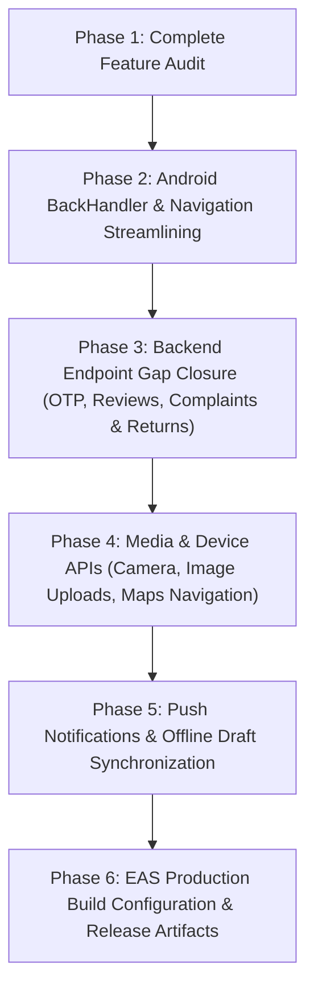

# VivoQuest Mobile Applications — Phase 1: Complete Feature & Architecture Audit Report

**Date:** October 30, 2026  
**Auditor:** Senior Software Architect & Mobile Application Auditor  
**Project Path:** `E:\VivoQuest Website`  
**Inspected Applications:**
1. `apps/mobile-patient` (VivoQuest Patient Mobile App)
2. `apps/mobile-caregiver` (VivoQuest Caregiver & Clinician Mobile App)
**Backend Path:** `apps/api` (REST API on port 4000)  
**Database:** MongoDB (`vivoquest_db` via Mongoose)

---

## Executive Summary & Readiness Index

The VivoQuest monorepo contains two distinct, high-fidelity mobile applications developed using the **Expo (Managed Workflow)** ecosystem with **React Native (0.88.0)**, **React (19.3.0)**, and **TypeScript (~6.0.3)**.

| Application | Primary Purpose | Primary Endpoints Connected | Verified LOC | Core Readiness |
| :--- | :--- | :--- | :--- | :--- |
| **`apps/mobile-patient`** | Patient home healthcare portal, caregiver subscription management, equipment store, cart, checkout & live order tracking. | 18 API routes | 4,258 lines (`App.tsx`) + 3,229 lines components | **75%** |
| **`apps/mobile-caregiver`** | Bedside clinical field tool, visit lifecycle execution, vitals recording, patient roster, credential management. | 14 API routes | 3,107 lines (`App.tsx`) + 672 lines services | **72%** |

Both applications have strong authentication foundations with hardware-backed encryption (`expo-secure-store`) and robust REST clients with dynamic host resolution. However, both applications lack native device modules for push notifications, camera/uploads, audio recording, local SQLite offline caching, and Android hardware back-button handling. In addition, several mature backend capabilities (delivery OTP display, customer reviews, ratings, product complaints, and return requests) exist on the backend but have not yet been integrated into the mobile UI.

---

# SECTION 1: Patient Mobile App Audit (`apps/mobile-patient`)

### 1.1 Login and Registration
- **Current Implementation:** Built in `src/components/LoginView.tsx` and orchestrated in `App.tsx`.
- **Authentication Modes:** Toggle between Phone + Password and Phone + OTP (simulated/backend OTP).
- **Registration Form:** Captures Full Name, 10-digit Phone, Email, Password, City, Pincode, and mandatory DPDP Act 2023 Consent Checkbox.
- **Storage:** Persists JWT Bearer token and user payload in `expo-secure-store` with iOS Keychain / Android Keystore hardware protection.
- **Role Verification:** Strictly verifies that the authenticated user possesses the `patient` role (or permitted administrative role).
- **Audit Findings:** Form validation is robust. Password visibility toggle works. Phone normalization handles `+91`, `91`, and leading `0`.
- **Classification:** `1. Fully implemented and verified`

### 1.2 Patient Dashboard (Home View)
- **Current Implementation:** `activeTab === 'home'` in `App.tsx`.
- **Widgets Implemented:**
  1. *Welcome Header:* Displays patient full name and status.
  2. *Active Care Subscription Card:* Shows plan title, subscription number, remaining visit count, total visits progress bar, and days active.
  3. *Assigned Caregiver Profile Card:* Displays assigned clinician name, phone, verified badge, and direct call trigger (`Linking.openURL('tel:...')`).
  4. *Next Scheduled Visit Card:* Displays upcoming date, standard time slot, visit status badge, and immediate reschedule trigger.
  5. *Recent Health Vitals Snippet:* Displays last recorded Systolic/Diastolic BP, SpO2, and Pulse.
  6. *Quick Action Grid:* Direct navigation to Store, Visits, Reports, and Plans.
- **Audit Findings:** Layout is clear and healthcare-focused. Pull-to-refresh (`RefreshControl`) correctly reloads dashboard data.
- **Classification:** `1. Fully implemented and verified`

### 1.3 Subscription Plans and Activation
- **Current Implementation:** `activeTab === 'plans'` in `App.tsx`.
- **Catalog Integration:** Fetches live caregiver plan tiers from `GET /api/v1/patients/caregiver-plans` (Post-Op Care, Elderly Care, Palliative Care, Chronic Care).
- **Activation Flow:** Modal view allows selecting plan duration, hours per visit, and entering Emergency Contact details (Name, Phone, Relationship) plus specific care instructions.
- **Execution:** Calls `POST /api/v1/patients/me/subscriptions/activate` in explicit test mode with an auto-generated idempotency key.
- **Audit Findings:** Works end-to-end. Immediately updates remaining visits and active subscription card on dashboard.
- **Classification:** `1. Fully implemented and verified`

### 1.4 Payment Integration
- **Current Implementation:** Integrated into `src/components/CartCheckoutModal.tsx` and `apiClient.ts`.
- **Gateway Endpoints:** Connects to `GET /products/payments/config`, `POST /products/payments/create-intent`, and `POST /products/payments/verify`.
- **Payment Options Available:**
  1. *Cash on Delivery (COD):* Fully working; marks payment status as `pending` with COD payment terms.
  2. *Online / Sandbox Mode:* Creates payment intent, but because the native Razorpay SDK (`react-native-razorpay`) is not installed, online payment is either simulated or requires web fallback.
- **Classification:** `2. Partially implemented` (COD & Sandbox Intent work; native Razorpay mobile SDK missing).

### 1.5 Medical Equipment Catalog
- **Current Implementation:** `src/components/EquipmentStoreView.tsx`.
- **Capabilities:**
  - Real-time search across product titles, descriptions, and SKUs.
  - Category pill filter: Mobility, Respiratory, Monitoring, Bathroom Safety, Orthopedic, Daily Living Aids.
  - Sourcing filter: All, Central VivoQuest Depot (`own_stock`), Third-Party Suppliers (`marketplace`).
  - Sorting: Featured, Price (Low to High, High to Low), Customer Rating.
  - Image resolver: Dynamically converts relative image paths to full HTTP URLs matching the active Metro/LAN API host.
- **Classification:** `1. Fully implemented and verified`

### 1.6 Cart and Checkout
- **Current Implementation:** `src/components/CartCheckoutModal.tsx`.
- **Server Validation:** Calls `POST /api/v1/products/cart/validate` prior to checkout to verify real-time inventory quantity, price alterations, and installation eligibility.
- **Address & Order Capture:** Captures street address, city, state, pincode, contact phone, and delivery instructions.
- **Stock Reservation:** On order placement, calls `POST /api/v1/products/orders` with an idempotency key, immediately decrementing warehouse stock and creating audit logs.
- **Classification:** `1. Fully implemented and verified`

### 1.7 Order History and Delivery Tracking
- **Current Implementation:** `src/components/MyOrdersModal.tsx`.
- **Order Tracking:** Displays 5-stage progress pipeline (`placed` → `confirmed` → `dispatched` → `out_for_delivery` → `delivered`).
- **Logistics Details:** Displays Blue Dart tracking number, courier dispatch partner, estimated delivery date, and order items.
- **Clinician Setup Scheduling:** For installation-eligible equipment, includes modal to schedule a clinician installation appointment with preferred date and time slot (`PATCH /orders/:id/setup-schedule`).
- **Cancellation:** Patients can cancel un-dispatched orders with mandatory cancellation reason.
- **Classification:** `5. Implemented but requires improvement` (Tracking works well; live map view and real-time delivery GPS coordinates missing).

### 1.8 Delivery OTP Verification (Flipkart-Style)
- **Current Implementation in Backend:** Fully implemented on backend via `POST /operations/orders/:id/request-delivery-otp` and `POST /operations/orders/:id/verify-delivery-otp`.
- **Mobile Patient App Status:** In `MyOrdersModal.tsx`, there is **no visible card displaying the customer's 6-digit delivery OTP** when an order reaches `out_for_delivery`.
- **Gap:** The customer cannot view the delivery OTP on their phone screen to read out to the delivery person.
- **Classification:** `4. Completely missing` on Mobile UI (Backend is ready; UI component not implemented).

### 1.9 Customer Ratings and Reviews
- **Current Implementation in Backend:** Backend supports `POST /products/:id/reviews` and `POST /products/orders/:id/delivery-rating`.
- **Mobile Patient App Status:** Catalog displays `averageRating` and `reviewCount`, but there is **no modal or screen for patients to submit a star rating, product review, or delivery experience rating**.
- **Classification:** `4. Completely missing` on Mobile UI.

### 1.10 Returns and Complaints
- **Current Implementation in Backend:** Backend supports `POST /products/orders/:idOrNumber/complaints`, `GET /products/complaints/my`, and `POST /products/orders/:idOrNumber/return`.
- **Mobile Patient App Status:** No interface exists in the mobile patient app to file a product complaint, upload photos of defective goods, or request a return pickup.
- **Classification:** `4. Completely missing` on Mobile UI.

### 1.11 Caregiver Assignment Details
- **Current Implementation:** `activeTab === 'caregiver'` in `App.tsx`.
- **Details:** Displays assigned clinician's full name, phone number, qualification/title, years of experience, direct call button, and current assignment status.
- **Classification:** `1. Fully implemented and verified`

### 1.12 Visit Scheduling and Rescheduling
- **Current Implementation:** `activeTab === 'visits'` in `App.tsx`.
- **Schedule Management:** Renders upcoming visits and historical visits with time slots and caregiver assignments.
- **Reschedule Request Modal:** Patients select an upcoming visit, pick a new date, select from 5 standard time slots (`08:00 AM - 10:00 AM` to `05:00 PM - 07:00 PM`), state a reason, and submit to `POST /patients/me/visits/:id/reschedule`.
- **Request Cancellation:** Patients can cancel pending reschedule requests.
- **Classification:** `1. Fully implemented and verified`

### 1.13 Clinical Reports and Vitals
- **Current Implementation:** `activeTab === 'reports'` in `App.tsx`.
- **Details:** Displays verified daily bedside reports submitted by caregivers with vital signs (Systolic/Diastolic BP, SpO2, Pulse, Temp), clinical observations, procedures performed, and caregiver recommendations.
- **Classification:** `1. Fully implemented and verified`

### 1.14 Notifications
- **Current Implementation:** Background polling every 10 seconds refreshes caregiver and visit data.
- **Gaps:** Neither push notifications (`expo-notifications`) nor an in-app notification center/bell drawer is implemented.
- **Classification:** `4. Completely missing`

### 1.15 Camera and Image Uploads
- **Current Implementation:** None. Neither `expo-camera` nor `expo-image-picker` is installed in `package.json`.
- **Gaps:** Patients cannot photograph medical prescriptions or damaged equipment.
- **Classification:** `4. Completely missing`

### 1.16 Voice Recording
- **Current Implementation:** None. Neither `expo-av` nor voice recording modules are present.
- **Classification:** `4. Completely missing`

### 1.17 Offline Support
- **Current Implementation:** Authentication token and user session persist in `expo-secure-store`.
- **Gaps:** No offline database (SQLite / WatermelonDB) caches products, orders, visits, or clinical reports. Network drops trigger error banners.
- **Classification:** `2. Partially implemented` (Auth persistence only; data caching missing).

### 1.18 Navigation and Android Back Button
- **Current Implementation:** Handled via custom React state (`activeTab`) and modal visibility flags (`isCartModalVisible`, `isOrdersModalVisible`, etc.).
- **Gaps:**
  1. No `BackHandler.addEventListener`: Pressing the physical or gesture back button on Android exits the app immediately rather than closing open modals or returning to the Home tab.
  2. Bottom tab bar contains **7 items with emojis** (`🏠`, `🩺`, `📅`, `📋`, `🛡️`, `🛒`, `👤`), which are cramped on standard mobile screens (~50px touch target).
- **Classification:** `5. Implemented but requires improvement`

---

# SECTION 2: Caregiver Mobile App Audit (`apps/mobile-caregiver`)

### 2.1 Login and Professional Registration
- **Current Implementation:** `src/components/LoginView.tsx` and `App.tsx`.
- **Authentication:** Phone login with password or OTP; strictly validates clinical roles (`caregiver`, `doctor`, `nurse`, `physiotherapist`).
- **Registration Form:** Captures clinical credentials: Full Name, Phone, Email, Role, Highest Qualification, Institution, Specialization, Years of Experience, and Document License ID.
- **Storage:** Persists token and session in `expo-secure-store`.
- **Classification:** `1. Fully implemented and verified`

### 2.2 Professional Profile and Credentials
- **Current Implementation:** `activeTab === 'profile'` in `App.tsx`.
- **Profile Display:** Shows verified status, specialization, institution, experience, and profile completion percentage.
- **Credentials List:** Lists clinical certificates, issuance dates, document categories, and validity/expiry alert badges.
- **Edit Modal:** Allows live editing of professional title, email, and institution calling `PUT /api/v1/professionals/me`.
- **Classification:** `1. Fully implemented and verified`

### 2.3 Assignment Notifications
- **Current Implementation:** Periodic polling in `App.tsx` every 10–15 seconds refreshes assigned visits and reschedule requests.
- **Gaps:** No push notifications (`expo-notifications` missing) to wake the device when an urgent home visit is assigned.
- **Classification:** `2. Partially implemented`

### 2.4 Accept / Reject Assignments
- **Current Implementation:** `activeTab === 'schedule'` in `App.tsx`.
- **Workflow:** For newly assigned visits in `scheduled` status, caregiver can click **Accept Assignment** (`POST /visits/:id/accept`) or **Reject Assignment** (`POST /visits/:id/reject`) with a mandatory rejection reason modal.
- **Classification:** `1. Fully implemented and verified`

### 2.5 Patient Roster
- **Current Implementation:** `activeTab === 'patients'` in `App.tsx`.
- **Directory:** Lists all patients assigned to the caregiver with full name, contact phone, complete residential address, emergency contact, chronic health conditions, active subscription plan tier, and total visits completed. Calls `GET /visits/provider/assigned-patients`.
- **Classification:** `1. Fully implemented and verified`

### 2.6 Visit Scheduling
- **Current Implementation:** `activeTab === 'schedule'` in `App.tsx`.
- **Scopes:** Filter tabs for `Today's Visits`, `Upcoming Visits`, and `Completed Visits`.
- **Card Information:** Displays patient name, visit time slot, address, cluster, telephone link, and action buttons.
- **Classification:** `1. Fully implemented and verified`

### 2.7 GPS and Navigation
- **Current Implementation:** Each visit card has a **Navigate / Open in Maps** button that launches external Google Maps or Apple Maps via `Linking.openURL('https://maps.google.com/?q=...')`.
- **Gaps:** Does not track background GPS coordinates (no `expo-location`).
- **Classification:** `2. Partially implemented`

### 2.8 Visit Lifecycle Execution
- **Current Implementation:** `activeTab === 'schedule'` in `App.tsx`.
- **Stage Progression:** Caregiver sequentially advances the visit status:
  `scheduled` → `accepted` → `en_route` → `arrived` → `in_progress` → `completed`.
- **API Call:** Each transition calls `PATCH /api/v1/visits/:id/status` which records authoritative timestamps in MongoDB.
- **Classification:** `1. Fully implemented and verified`

### 2.9 Clinical Documentation & Vitals Recording
- **Current Implementation:** `activeTab === 'record'` in `App.tsx`.
- **Vitals Inputs:** Systolic BP, Diastolic BP, Pulse Rate, SpO2 (Oxygen Saturation), Body Temperature (°F), Blood Glucose (mg/dL), Pain Score (1–10 visual scale), and Respiratory Rate.
- **Clinical Narrative:** Free-text clinical observation notes and medical recommendations.
- **Procedures Checklist:** Toggleable procedures performed (Vitals Assessment, Wound Dressing, Medication Administration, Mobility Assistance, Hygiene Care).
- **Backend Sync:** Submits directly to `POST /api/v1/visits/:id/documentation`, creating a daily care report and updating visit status to `completed`.
- **Classification:** `1. Fully implemented and verified`

### 2.10 Camera and Image Uploads
- **Current Implementation:** None. Neither `expo-camera` nor `expo-image-picker` is installed.
- **Gaps:** Caregivers cannot photograph bedside wound healing, patient charts, or prescriptions.
- **Classification:** `4. Completely missing`

### 2.11 Voice Recording and Transcription Readiness
- **Current Implementation:** None. Neither `expo-av` nor audio recording packages are installed.
- **Gaps:** Clinical dictation / voice-to-text is not available.
- **Classification:** `4. Completely missing`

### 2.12 Rescheduling Requests (Caregiver Side)
- **Current Implementation:** `activeTab === 'schedule'` in `App.tsx`.
- **Workflow:** Renders pending patient reschedule requests. Caregiver can **Approve** (`POST /visits/reschedule-requests/:id/approve`) or **Reject** with mandatory reason (`POST /visits/reschedule-requests/:id/reject`).
- **Classification:** `1. Fully implemented and verified`

### 2.13 Offline Drafts and Synchronization
- **Current Implementation:** None. Auth tokens persist in `expo-secure-store`, but clinical vitals forms do not save local drafts. If a caregiver is inside a basement or low-connectivity home, submitting documentation fails immediately.
- **Classification:** `4. Completely missing`

### 2.14 Notifications
- **Current Implementation:** Polling only. Push notifications are missing.
- **Classification:** `4. Completely missing`

### 2.15 Navigation and Android Back Button
- **Current Implementation:** 4-tab bottom navigation (`Schedule`, `Record Vitals`, `My Patients`, `Profile`) rendered with plain text only (no icons).
- **Gaps:**
  1. Missing Android `BackHandler.addEventListener`: Pressing hardware back button exits the app.
  2. Tab bar lacks icons and uses plain text buttons.
- **Classification:** `5. Implemented but requires improvement`

---

# SECTION 3: Backend Integration Matrix

| Feature | HTTP Method & Endpoint | Backend Model | Auth Required | Mobile Status | Data Integrity Check |
| :--- | :--- | :--- | :--- | :--- | :--- |
| **Patient Login** | `POST /api/v1/auth/login` | `User` | Public | **Connected** | Validated JWT Bearer token |
| **Patient Register** | `POST /api/v1/auth/register` | `User` | Public | **Connected** | DPDP consent stored |
| **Patient Subscriptions** | `GET /api/v1/patients/me/subscriptions` | `CaregiverSubscription` | Bearer (patient) | **Connected** | Live remaining visit balance |
| **Activate Subscription** | `POST /api/v1/patients/me/subscriptions/activate` | `CaregiverSubscription` | Bearer (patient) | **Connected** | Idempotency key supported |
| **Browse Caregiver Plans**| `GET /api/v1/patients/caregiver-plans` | `CaregiverPlan` | Public / Bearer | **Connected** | Active tiers only |
| **Assigned Caregiver** | `GET /api/v1/patients/me/caregiver` | `User` (professional) | Bearer (patient) | **Connected** | Contact & title mapped |
| **Patient Visits** | `GET /api/v1/patients/me/visits` | `FieldVisit` | Bearer (patient) | **Connected** | Upcoming vs past split |
| **Request Reschedule** | `POST /api/v1/patients/me/visits/:id/reschedule` | `VisitRescheduleRequest` | Bearer (patient) | **Connected** | Slot validation enforced |
| **Cancel Reschedule** | `POST /api/v1/patients/me/reschedule-requests/:id/cancel` | `VisitRescheduleRequest` | Bearer (patient) | **Connected** | Reverts visit status |
| **Daily Care Reports** | `GET /api/v1/patients/me/care-reports` | `DailyCareReport` | Bearer (patient) | **Connected** | Vitals and notes rendered |
| **Submit Health Update** | `POST /api/v1/patients/health-updates` | `DailyCareReport` | Bearer (patient) | **Connected** | Self-reported vitals |
| **Equipment Catalog** | `GET /api/v1/products` | `MedicalProduct` | Public / Bearer | **Connected** | Search & category filters |
| **Single Product** | `GET /api/v1/products/:id` | `MedicalProduct` | Public / Bearer | **Connected** | Gallery & specs mapped |
| **Validate Cart** | `POST /api/v1/products/cart/validate` | `MedicalProduct` | Bearer (patient) | **Connected** | Price & stock revalidated |
| **Create Order** | `POST /api/v1/products/orders` | `ProductOrder` | Bearer (patient) | **Connected** | Stock reservation logged |
| **List Orders** | `GET /api/v1/products/orders` | `ProductOrder` | Bearer (patient) | **Connected** | Normalized IDs & stages |
| **Schedule Setup** | `PATCH /api/v1/products/orders/:id/setup-schedule` | `ProductOrder` | Bearer (patient) | **Connected** | Clinician visit scheduled |
| **Cancel Order** | `POST /api/v1/products/orders/:id/cancel` | `ProductOrder` | Bearer (patient) | **Connected** | Unreserves stock |
| **Delivery OTP Display** | `GET /api/v1/products/orders/:id` (`deliveryOtp`) | `ProductOrder` | Bearer (patient) | **MISSING IN UI** | Backend generates OTP; mobile UI has no display card |
| **Product Rating & Review**| `POST /api/v1/products/:id/reviews` | `ProductReview` | Bearer (patient) | **MISSING IN UI** | Backend endpoint ready; mobile UI missing |
| **Delivery Rating** | `POST /api/v1/products/orders/:id/delivery-rating` | `DeliveryRating` | Bearer (patient) | **MISSING IN UI** | Backend endpoint ready; mobile UI missing |
| **Product Complaints** | `POST /api/v1/products/orders/:id/complaints` | `ProductComplaint` | Bearer (patient) | **MISSING IN UI** | Backend endpoint ready; mobile UI missing |
| **Product Return Request**| `POST /api/v1/products/orders/:id/return` | `ProductOrder` | Bearer (patient) | **MISSING IN UI** | Backend endpoint ready; mobile UI missing |
| **Presigned Upload URL**| `POST /api/v1/uploads/presigned` | `UploadedFile` | Bearer | **MISSING IN UI** | Backend direct upload ready; mobile client missing |
| **Caregiver Visits** | `GET /api/v1/visits/provider/me` | `FieldVisit` | Bearer (caregiver) | **Connected** | Filtered by date/status |
| **Accept Visit** | `POST /api/v1/visits/:id/accept` | `FieldVisit` | Bearer (caregiver) | **Connected** | Changes status to accepted |
| **Reject Visit** | `POST /api/v1/visits/:id/reject` | `FieldVisit` | Bearer (caregiver) | **Connected** | Mandatory reason required |
| **Update Visit Status** | `PATCH /api/v1/visits/:id/status` | `FieldVisit` | Bearer (caregiver) | **Connected** | Lifecycle timestamps |
| **Record Documentation**| `POST /api/v1/visits/:id/documentation` | `FieldVisit` + `Report`| Bearer (caregiver) | **Connected** | Vitals and procedures |
| **Assigned Patients** | `GET /api/v1/visits/provider/assigned-patients` | `User` + `Subscription`| Bearer (caregiver) | **Connected** | Chronic history loaded |
| **Approve Reschedule** | `POST /api/v1/visits/reschedule-requests/:id/approve` | `VisitRescheduleRequest` | Bearer (caregiver) | **Connected** | Syncs new slot to visit |
| **Reject Reschedule** | `POST /api/v1/visits/reschedule-requests/:id/reject` | `VisitRescheduleRequest` | Bearer (caregiver) | **Connected** | Reason returned to patient |
| **Caregiver Profile** | `GET /api/v1/professionals/me` | `ProfessionalProfile` | Bearer (caregiver) | **Connected** | Credentials & score |
| **Update Profile** | `PUT /api/v1/professionals/me` | `ProfessionalProfile` | Bearer (caregiver) | **Connected** | Edits title & institution |
| **Manage Credentials** | `POST/DEL /api/v1/professionals/me/credentials` | `ProfessionalProfile` | Bearer (caregiver) | **Connected** | Document metadata sync |

---

# SECTION 4: UI/UX Audit & Screen-by-Screen Recommendations

### 4.1 Patient App UI/UX Issues

#### Issue 1: Overcrowded Bottom Navigation Bar
- **Current State:** 7 items with emoji icons (`Home`, `Caregiver`, `Visits`, `Reports`, `Plans`, `Equipment`, `Profile`) squeezed into a single horizontal bar.
- **Usability Impact:** Touch targets are ~50px wide, causing accidental taps and text truncation on compact screens (e.g., 360px width).
- **Recommendation:** Restructure into a standard **5-tab bottom navigation**:
  1. `Home` (Overview, next visit, active plan)
  2. `Store` (Medical equipment catalog & orders shortcut)
  3. `Care` (Assigned caregiver & daily care reports)
  4. `Visits` (Visit schedule & rescheduling)
  5. `Profile` (Account, DPDP consent, emergency contact, settings)
  Replace emoji icons with professional vector icons (`@expo/vector-icons`).

#### Issue 2: Missing Android Hardware Back-Button Support
- **Current State:** Neither `App.tsx` nor modals import `BackHandler`.
- **Usability Impact:** Pressing the Android hardware back button or swipe-back gesture terminates the app rather than closing active modals (Cart, Order Detail, Reschedule) or switching back to the Home tab.
- **Recommendation:** Implement a top-level `BackHandler` hook that prioritizes:
  1. Dismissing open modals.
  2. Navigating back from nested views to `home`.
  3. Prompting for exit confirmation only when on the `home` root tab.

#### Issue 3: Inconsistent Color Palette & Button Hierarchy
- **Current State:** Mixed use of emerald green (`#0D9488`), primary blue (`#1976D2`), royal blue (`#2563EB`), and dark navy (`#17324D`) across buttons and cards.
- **Recommendation:** Standardize on the official VivoQuest Design Tokens:
  - Deep Navy (`#17324D`) for primary app headers and titles.
  - Teal (`#0D9488`) for primary CTAs and active states.
  - Emerald Green (`#16A34A`) for verified badges, successful deliveries, and healthy vitals.
  - Amber (`#D97706`) for pending actions and warnings.
  - Rose (`#DC2626`) for cancellations and critical vitals.

#### Issue 4: Modal Overuse and Deep Stacking
- **Current State:** Modals are used for Product Details, Cart, Order Confirmation, Order Tracking, Setup Scheduling, and Clinical Report Details, occasionally nesting modals within modals.
- **Recommendation:** Migrate to Expo Router screen routes (`app/`) or stacked cards with clear transition headers to prevent Android modal memory leaks and visual glitches.

---

### 4.2 Caregiver App UI/UX Issues

#### Issue 1: Text-Only Bottom Navigation
- **Current State:** The bottom tab bar renders 4 buttons with plain text strings: `Schedule`, `Record Vitals`, `My Patients`, `Profile`.
- **Usability Impact:** Lacks visual affordance and looks unfinished compared to the patient app.
- **Recommendation:** Add modern clinical icons (`calendar`, `activity`, `users`, `user`) with badge indicators (e.g. badge showing count of pending reschedule requests or new assignments).

#### Issue 2: Vitals Form Usability in Bedside Scenarios
- **Current State:** Long scrollable form with small text inputs for 8 vitals metrics.
- **Usability Impact:** Clinicians wearing clinical gloves or multitasking bedside find small numeric inputs difficult to tap accurately.
- **Recommendation:**
  - Increase input field height to minimum `52dp`.
  - Add quick increment/decrement steppers (`+` / `-`) for Blood Pressure, Pulse, and Respiratory Rate.
  - Provide abnormal vitals highlighting (e.g. yellow/red warning badge when Systolic BP > 140 or SpO2 < 94%) to assist clinical triage.

#### Issue 3: Missing Offline Draft Protection
- **Current State:** If internet connectivity drops while documenting vitals, pressing "Submit Daily Care Report" shows a network failure alert and risks losing typed observations.
- **Recommendation:** Auto-save form inputs to `AsyncStorage` / `SecureStore` every 5 seconds. If offline, save to a local "Pending Submissions" queue and automatically dispatch once connectivity resumes.

---

# SECTION 5: Comprehensive Feature Classification

| # | Feature Name | Application | Classification | Key Findings & Recommendations |
| :--- | :--- | :--- | :--- | :--- |
| 1 | Patient Login & Register | Patient | **1. Fully implemented and verified** | SecureStore JWT persistence, DPDP consent, role validation. |
| 2 | Patient Dashboard | Patient | **1. Fully implemented and verified** | Real-time subscriptions, assigned caregiver, upcoming visit. |
| 3 | Subscription Plans & Activation | Patient | **1. Fully implemented and verified** | Live catalog, test-mode activation, emergency contact capture. |
| 4 | Payment Integration | Patient | **2. Partially implemented** | COD & Sandbox work; native Razorpay mobile SDK missing. |
| 5 | Medical Equipment Catalog | Patient | **1. Fully implemented and verified** | Search, category filters, sourcing type toggle, image resolver. |
| 6 | Cart & Stock Checkout | Patient | **1. Fully implemented and verified** | Server-side price validation, stock reservation, idempotency key. |
| 7 | Order History & Tracking | Patient | **5. Implemented but requires improvement** | 5-stage progress, setup scheduling; live GPS tracking missing. |
| 8 | Delivery OTP Verification | Patient | **4. Completely missing** (Mobile UI) | Backend is ready; customer OTP display card missing in mobile UI. |
| 9 | Product Rating & Reviews | Patient | **4. Completely missing** (Mobile UI) | Backend endpoints ready; mobile review/rating submission modal missing. |
| 10 | Delivery Experience Rating | Patient | **4. Completely missing** (Mobile UI) | Backend endpoint ready; 5-star delivery feedback UI missing. |
| 11 | Product Complaints & Returns | Patient | **4. Completely missing** (Mobile UI) | Backend endpoints ready; complaint and return request UI missing. |
| 12 | Assigned Caregiver Profile | Patient | **1. Fully implemented and verified** | Direct telephone dialer, verified badge, experience summary. |
| 13 | Visit Scheduling & Reschedule | Patient | **1. Fully implemented and verified** | 5 standard time slots, reason capture, cancellation of requests. |
| 14 | Bedside Clinical Reports | Patient | **1. Fully implemented and verified** | Vitals breakdown, caregiver notes, hide from personal feed. |
| 15 | Self-Reported Health Updates | Patient | **1. Fully implemented and verified** | Direct API submission of patient symptoms and vitals. |
| 16 | Patient Push Notifications | Patient | **4. Completely missing** | `expo-notifications` missing; in-app notification bell missing. |
| 17 | Patient Camera / Prescriptions | Patient | **4. Completely missing** | `expo-camera` / `expo-image-picker` missing. |
| 18 | Patient Voice Notes | Patient | **4. Completely missing** | `expo-av` missing. |
| 19 | Patient Offline Support | Patient | **2. Partially implemented** | Auth session persists; product/order/visit caching missing. |
| 20 | Patient Android Back Button | Patient | **5. Implemented but requires improvement** | Missing `BackHandler.addEventListener`; exits app on hardware back. |
| 21 | Caregiver Login & Register | Caregiver | **1. Fully implemented and verified** | Role validation, clinical qualification & institution capture. |
| 22 | Professional Profile & Certs | Caregiver | **1. Fully implemented and verified** | Verified badge, expiry alerts, completion %, credential editing. |
| 23 | Assignment Polling Alerts | Caregiver | **2. Partially implemented** | Polling works; background wake & push notifications missing. |
| 24 | Accept / Reject Assignments | Caregiver | **1. Fully implemented and verified** | Assignment acceptance and mandatory rejection reason modal. |
| 25 | Assigned Patients Directory | Caregiver | **1. Fully implemented and verified** | Addresses, chronic conditions, emergency contacts, plan tiers. |
| 26 | Field Visit Scheduling | Caregiver | **1. Fully implemented and verified** | Filter by today, upcoming, completed; address and cluster tags. |
| 27 | GPS & Route Navigation | Caregiver | **2. Partially implemented** | Launches external Google/Apple Maps; live GPS check-in missing. |
| 28 | Visit Lifecycle Progression | Caregiver | **1. Fully implemented and verified** | Status sequence from scheduled to completed with timestamps. |
| 29 | Bedside Vitals Recording | Caregiver | **1. Fully implemented and verified** | Form for 8 vital signs, clinical notes, procedures checklist. |
| 30 | Caregiver Camera / Wound Photos | Caregiver | **4. Completely missing** | `expo-image-picker` missing. |
| 31 | Caregiver Voice Dictation | Caregiver | **4. Completely missing** | Audio dictation missing (`expo-av`). |
| 32 | Reschedule Approval/Rejection | Caregiver | **1. Fully implemented and verified** | Approve / reject patient reschedule requests with reasons. |
| 33 | Offline Clinical Drafts & Sync | Caregiver | **4. Completely missing** | Drafts not saved; network drop loses un-submitted documentation. |
| 34 | Caregiver Push Notifications | Caregiver | **4. Completely missing** | Missing `expo-notifications`. |
| 35 | Caregiver Navigation & Back Button| Caregiver | **5. Implemented but requires improvement** | Text-only bottom tabs; missing `BackHandler.addEventListener`. |

---

# SECTION 6: Technical Dependencies & Missing Libraries

To bring both applications to 100% production readiness, the following Expo SDK 58 compatible libraries are required:

```bash
# In apps/mobile-patient:
npx expo install @expo/vector-icons expo-notifications expo-image-picker expo-location

# In apps/mobile-caregiver:
npx expo install @expo/vector-icons expo-notifications expo-image-picker expo-location @react-native-async-storage/async-storage
```

---

# SECTION 7: Recommended Implementation Roadmap (Phase 2 & Beyond)



### Stage 1 (Immediate Priority): Android Usability & Navigation
1. Add `BackHandler` listeners to both applications so hardware/gesture back navigates backwards and dismisses open modals.
2. Replace crowded 7-tab bar in Patient App with standard 5-tab layout using `@expo/vector-icons`.
3. Add clinical vector icons to Caregiver App bottom navigation bar.

### Stage 2: Connect Existing Mature Backend Features to Patient App
1. **Delivery OTP Display Card:** In `MyOrdersModal.tsx`, display the secure 6-digit delivery OTP prominently when order status is `out_for_delivery`.
2. **Product Review & Rating Modal:** Add star rating and review submission for delivered items calling `POST /products/:id/reviews`.
3. **Delivery Experience Rating:** Add 5-star delivery feedback modal calling `POST /products/orders/:id/delivery-rating`.
4. **Returns & Complaints Modal:** Add return pickup request and complaint filing calling `POST /products/orders/:id/return` and `POST /products/orders/:id/complaints`.

### Stage 3: Caregiver Bedside Polish & Offline Resilience
1. Implement local draft auto-saving in `AsyncStorage` for bedside vitals forms to prevent data loss during poor connectivity.
2. Add abnormal vitals alert indicators on the recording screen.
3. Add `package` and `bundleIdentifier` (`com.vivoquest.caregiver`) to `apps/mobile-caregiver/app.json`.

### Stage 4: Native Capabilities & Cloud Builds
1. Implement `expo-image-picker` for prescription and clinical document uploads via `/api/v1/uploads/presigned`.
2. Configure `expo-notifications` for real-time visit and order notifications.
3. Configure `eas.json` for standalone Android APK/AAB and iOS IPA builds.

---

# SECTION 8: Estimated Implementation Complexity & Testing Strategy

### Complexity Breakdown
- **Navigation & BackHandler Fixes:** **Low** (1 day)
- **OTP, Reviews, Ratings, Complaints & Returns UI Integration:** **Medium** (2 days, backend endpoints are already built and tested)
- **Offline Draft Saving & Sync:** **Medium** (1.5 days)
- **Camera & Image Uploads (`expo-image-picker` + presigned S3):** **Medium** (1.5 days)
- **Push Notifications (FCM / APNs configuration):** **High** (2 days, requires Google Services / Apple Developer certificates)
- **EAS Build Pipeline Setup:** **Medium** (1 day)

### Recommended Testing Strategy
1. **Headless Component & Service Tests:** Run automated test scripts using Node.js / Jest for `apiClient.ts` and `authStorage.ts`.
2. **Device Emulation Testing:** Test both applications in Android Emulator (`Pixel 7 / Android 14`) and iOS Simulator to verify layout scaling, keyboard dismiss behavior, and modal transitions.
3. **Physical Device QR Testing:** Verify via Expo Go on physical Android and iOS devices over LAN.
4. **Offline Resilience Testing:** Simulate airplane mode during vitals entry and order tracking to verify error banners and draft preservation.

---

**AUDIT CONCLUSION:**  
The existing codebase provides a solid, mature foundation with clean TypeScript architecture and real backend connectivity. The missing items are largely native module additions, Android hardware back-button handling, and UI integration of already-built backend endpoints. No structural rewrite is needed.

